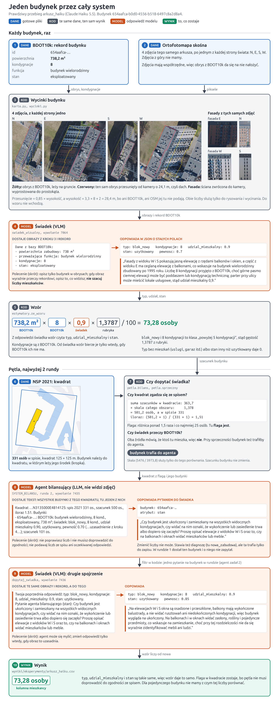

# wroclaw-population-agents

Szacujemy, ile osób mieszka w każdym budynku we Wrocławiu. Zakładamy, że model ruchu będzie dokładniejszy z takim wyliczeniem, a spis GUS podaje ludność tylko w kwadratach 125 × 125 m.

Model widzący obrazy (VLM), czyli świadek, opisuje budynek ze zdjęć lotniczych z 4 stron świata, a liczbę mieszkańców liczy z tego wzór ze stałymi z literatury. Drugi model, agent bilansujący, dostaje rozjazdy ze spisem i dopytuje świadka.

Pilot to jeden arkusz ortofotomapy (800 × 500 m, 341 budynków), a największy dotąd przebieg to 5 arkuszy (1044 budynki) na tanim modelu Claude Haiku. Docelowo cały Wrocław (826 arkuszy, ok. 70 tys. budynków) przejdzie przez otwarty Qwen3.8-27B na własnym serwerze, a wynik ocenimy na końcu na SRLM, szacowanej rzeczywistej liczbie mieszkańców w 375 rejonach; instrukcja: `docs/serwer.md`. Architektura: `docs/architektura.md`, pełne prompty: `src/agenci/`, stan prac: `paper/population-estimation.tex`, wykresy: `notebooks/`.

## Instalacja i dane

Python 3.12+: `uv sync` albo `pip install -e .` (wtedy bez `uv run`).

Arkusze ortofotomapy pobiera `uv run python -m ortofoto.pobierz <godło> ...` (np. `6.148.12.04.2`), BDOT10k z [geoportalu Dolnego Śląska](https://geoportal.dolnyslask.pl/imap/#gpmap=gp103), a `Grid_125_XLS.zip` z [ATOM GRID w GUS](https://geo.stat.gov.pl/atom-web/atom/GRID?spatial_dataset_identifier_code=GRID_2021_125m_xls&spatial_dataset_identifier_namespace=GRID), rozpakuj i ułóż tak, bez zmiany nazw:

```text
data/*_<godło>_{N,E,S,W}.tif                    ok. 80 MB każdy
data/*/BDOT10K/PL.PZGiK.337.0264__OT_BUBD_A.xml  powiat 0264, ok. 320 MB
data/populacja/Grid_125_{1,2}.xlsx
```

## Użycie

Jeden plik `eksperymenty/*.toml` to jeden przebieg. Pole `estymator` wybiera wariant: `objetosc` to powierzchnia × wysokość, `objetosc_bdot` to samo, ale 0 dla niemieszkalnych i nieużytkowanych, `wzor` to świadek i wzór, a `petla` dodaje pętlę.

```toml
estymator = "petla"
z_rekordem = true  # czy modele widzą rekord BDOT10k
model = "claude-haiku-5-5"
[budynki]
wszystkie = true   # albo kwadraty = 3, albo liczba = 40
```

```bash
uv run python -m agenci.eksperyment eksperymenty/arkusz_haiku.toml --na-sucho  # bez API i zapisu
ANTHROPIC_API_KEY=... uv run python -m agenci.eksperyment eksperymenty/arkusz_haiku.toml
uv run python -m agenci.ewaluacja   # porównanie przebiegów
uv run pytest
```

Ocena na końcu: `uv run python -m agenci.ewaluacja --srlm` porównuje każdy przebieg z SRLM, czyli szacowaną rzeczywistą liczbą mieszkańców w 375 rejonach komunikacyjnych (raport UWr dla UMW, 2023, w BIP UMW; plik do `data/SRLM/`). SRLM liczy też niezameldowanych, więc jest o ok. 33% wyższy od NSP 2021. Oceniamy rejony, których co najmniej 95% powierzchni mieszkalnej ma predykcję; baseline dostaje ludność NSP rozłożoną wg objętości. `[budynki] rejon = 30` zawęża przebieg do kwadratów NSP przecinających rejon 30 (`eksperymenty/srlm30_*.toml`).

Wyniki trafiają do `wyniki/eksperymenty/`: `<przebieg>.csv` (jeden wiersz na budynek), `__dialog.csv` (rozmowa agentów), `__bilans.csv` (kwadraty po rundach). Odpowiedzi modeli zostają w `wyniki/eksperymenty.sqlite`, więc powtórka jest darmowa, chyba że zmieni się prompt. Katalogu `wyniki/` nie ma w gicie.

## Jak wyglądają dane

| Źródło | Co to jest | Czego używamy |
| --- | --- | --- |
| Ortofotomapa skośna | Cztery pliki TIF czyli cztery fotografie z kierunków N, S, W, E, piksel to 5 cm, jeden TIF to 500m x 800m | obrazy dla modelu |
| BDOT10k | Państwowa baza budynków z różnymi danymi o nich | obrys (stąd powierzchnia), funkcja, kondygnacje, stan |
| NMPT i NMT (GUGiK) | Wysokość powierzchni z dachami i samego terenu ze skaningu laserowego (LiDAR), piksel 0,5 m i 1 m | wysokość budynku |
| OpenStreetMap | Otwarta mapa, obrysy i punkty adresowe | adres budynku |
| NSP 2021 | Spis powszechny, liczba osób w kwadracie 15m x 125m | gdy jest duża rozbieżność między spisem a sumą dla budynków w kwadracie to odpalamy agenta bilansującego |

Spis przypisuje ludzi do punktów adresowych, a długi blok leży w kilku kwadratach, więc mieszkańców budynku dzielimy między kwadraty według tego, jaka część jego obrysu leży w każdym. Kwadraty na brzegach się ucinają więc dopóki działamy na jednym arkuszu to te kwadraty których wszystkie budynki mieszkalne leżą na arkuszu.

Zdjęcia TIG mają współrzędne, więc obrys z BDOT10k da się na nie łatwo nałożyć. Model dostaje z tych zdjęć 4 fasady (czyli wycinki tych samych zdjęć ze ścianą wyprostowaną do prostokąta). Przy krawędzi arkusza 31 budynków ma 3 zdjęcia, a 30 nie ma żadnego i dostaje sam rekord.

## Jeden budynek od początku do końca

Prawdziwy przebieg modlei na Claude Haiku dla akademika przy pl. Grunwalldzkim Wzór daje 322 osoby, a spis ma w tym kwadracie 33, więc kwadrat dostaje flagę i odpala się agent bilansujący - Agent dopytuje świadka, świadek potwierdza swój opis i wynik się nie zmienia.



Odpowiedzi modeli są dosłowne, a prompty które dostały skrócone.

### Wzór i rubryka

```text
dom:                      osoby_na_dom × udział
wielorodzinny, zbiorowy:  powierzchnia × kondygnacje × udział / m² na osobę
```

 Stałe tego ile ludzi mieszka średnio dla typu budynku bierzemy z literatury i hardocdujemy w `estymatory.py`. Powierzchnia to obrys × kondygnacje z BDOT10k.

| Klasa | Wartość w kodzie | Na 100 m² | Źródło |
| --- | --- | --- | --- |
| dom | 2,88 osoby na budynek | | [Pirowski i Bartos 2018](https://doi.org/10.15292/geodetski-vestnik.2018.03.458-471), tab. 1, wariant 3; te same liczby w [Pirowski i Szypuła 2024](https://doi.org/10.1080/24694452.2024.2313500) |
| budynek wielorodzinny | 37,08 m² na osobę | 2,70 osoby | jak wyżej |
| zamieszkanie zbiorowe | 31 m² na miejsce | 3,23 osoby | [College Housing Report 2014](http://www.mahlum.com/pdf/CPM2014CollegeHousingReport%281%29.pdf), tab. 1: mediana 333,3 stopy² z 52 akademików w USA |

Pracy z takimi liczbami dla samego Wrocławia nie znaleźliśmy, więc bierzemy Kraków. Pirowski i Bartos liczą z tej samej bazy BDOT10k i z tą samą definicją powierzchni co my, a mieszkania w obu miastach są podobne: GUS na koniec 2024 roku podaje 34,6 m² użytkowych na osobę i 1,71 osoby na mieszkanie we [Wrocławiu](https://www.polskawliczbach.pl/Wroclaw) oraz 33,4 m² i 1,73 osoby w [Krakowie](https://www.polskawliczbach.pl/Krakow). Różnica jest mała, więc pracujemy na tych stałych skoro nie mamy danych o zużyciu wody.

Dla akademików polskiego źródła nie znaleźliśmy, a liczba, którą wzieliśmy pochodzi z ankiety branżowego pisma z USA. Ponad połowa tamtych akademików ma też sale zajęciowe, a nasza klasa obejmuje też klasztory i domy opieki. Dla porównania [Dom Studencki nr 7 UW](https://www.uw.edu.pl/standard-domu-studenckiego-nr-7-uw/) ma prawie 13 000 m² i ponad 380 miejsc, czyli ok. 34 m² na miejsce, licząc z kondygnacją podziemną. TU MOŻNA WZIĄĆ POTEM STAŁĄ DLA ZABUDOWY RODZINNEJ

### Co daje świadek

Świadek to VLM i patrzy na otrzymane fasady i informacje o budynku z BDOT. Prompt każe mu odpowiedzieć w JSON o stałych polach, żeby potem to łądnie wczytać w kodzie. JSON ma `typ` który wybiera klasę rubryki (czyli dom, lub wielorodzinna, lub zamieszkanie zbiorowe) albo daje 0 (`uslugi`, `przemysl`, `garaz`), `udzial_mieszkalny` mnoży wynik (czyli np. tutaj damy udzial=0.8 bo na 1 pietrze z 5 nikt nie mieszka), a `stan` inny niż `uzytkowany` daje 0 (bo np. budynek jest zniszczony). Daje jescze `kondygnacje` czyli liczbe pięter, ale od VLM ierzemy je tylko wtedy gdy w BDOT10k ich ni ma (9 z 341 budynków) dla arkusza z Grnwaldu.

VLM dostaje powierzchnię i kondygnacje z BDOT10k.

W pilocie od świadka zależy praktycznie tylko udział mieszkalny. Klasa budynku zgadza się z BDOT10k w 330 z 341 budynków, stan to `uzytkowany` w 338, a udział wynosi od 0,8 do 0,95 w 241 z 246 budynków z szacunkiem powyżej zera.

### Wysokość i dach na zdjęciu

BDOT10k nie ma pola wysokości, tylko kondygnacje. Wysokość bierzemy ze skaningu laserowego GUGiK: mediana NMPT w obrysie budynku minus teren z NMT (340 z 341 budynków). Kod pobiera oba rastry sam przy pierwszym uruchomieniu i zapisuje je w `data/`. Budynek, którego skaning jeszcze nie widział, dostaje 3,3 m × kondygnacje + 2 m (1 budynek w budowie).

Dach leży na zdjęciu o 0,96 × wysokość od podstawy, w stronę od kamery. Mnożnik to tangens odchylenia kamery od pionu (ok. 44°). Wyznaczyliśmy go, dopasowując teksturę dachu między czterema widokami i dzieląc znalezione przesunięcie przez wysokość z LiDAR-u: na 61 budynkach z pewnym dopasowaniem mediana to 0,96, a cztery kierunki dają od 0,955 do 0,976.

Znając tę trygonometrią możemy rysować obryss dachu i wycinać fasady. Wysokość liczy też baseline objętości, a do wzoru weszłaby tylko przy braku kondygnacji i w BDOT10k, i u świadka. W pilocie się to nie zdarzyło.

## Jak działa pętla

Kwadrat dostaje flagę, gdy szacunek po skalowaniu do spisu różni się od niego ponad 1,5 raza i o co najmniej 25 osób. To nasz próg, sprawdzony w symulacji. Pętla rusza przy fladze albo gdy świadek przeczy BDOT10k, np. pisze, że nikt nie mieszka w budynku mieszkalnym.

Agent nie widzi zdjęć. Czyta opisy takich budynków i wybiera, o co zapytać świadka. To jego jedyny wpływ na wynik, bo liczb nie zmienia, a diagnozy trafiają tylko do zapisu.

Filtr w kodzie przepuszcza pytania tylko o te budynki, jedno na budynek w rundzie, bez powtórek, najwyżej 20 z jednego wywołania agenta (limit kosztu; agent dostaje kwadraty w paczkach po 25), i wycina z nich cyfry, żeby świadek nie poznał liczb ze spisu. Świadek ma zmienić zdanie tylko wtedy, gdy uzasadnia to obraz, a wzór liczy wszystko od nowa. Rundy są najwyżej 2 (Du i in. 2024).

W pilocie flagę ma 1 z 14 kwadratów, ten z przykładu. Agent zapytał o 7 budynków, a świadek zmienił 2 opisy, w tym blok opisany wcześniej jako usługi. Suma arkusza wzrosła z 8921 do 8942 osób. Wynik końcowy to kolumna `mieszkancy`, a stan sprzed pętli to `mieszkancy_r0`.


## Szperacz

Większość ludzi i błędu siedzi w kilku dużych budynkach. Przy `szukaj = true` model z wyszukiwarką internetową (szperacz) dostaje adresy i rekord najwyżej 4 budynków z każdego arkusza: najpierw typu `zbiorowy`, potem tych z największym szacunkiem. Szuka liczby miejsc albo mieszkań podanej dla tego konkretnego budynku, najwyżej 2 zapytaniami. Liczba miejsc zastępuje szacunek, a liczbę mieszkań mnożymy przez 1,71 osoby (GUS, Wrocław, 2024). Bez źródła zostaje wynik wzoru (`mieszkancy_wzor`); stronę i zdanie z liczbą zapisujemy w `zrodlo` i `cytat`.

Na 5 arkuszach (20 budynków, 0,43 USD) szperacz znalazł liczbę dla 6, np. 802 miejsca w akademiku przy Piastowskiej 1. Dwa trafienia są wątpliwe (wiersz tabeli bez nagłówka, miejsca dla turystów), więc źródła trzeba przejrzeć; wyniki są w `notebooks/piec_arkuszy.ipynb`.

## Co sprawdzamy

Dla pojedynczego budynku nie mamy prawdziwej liczby mieszkańców, więc sumy w kompletnych kwadratach porównujemy ze spisem. Rubryka nie pochodzi ze spisu, więc stan przed pętlą to ocena niezależna. Spearman mówi, czy kolejność kwadratów się zgadza, a WAPE, jaką część ludzi trzeba by przesunąć między kwadratami. Przed WAPE każdą serię skalujemy do sumy spisu, więc oceniamy rozkład i da się porównać objętość w m³ z osobami. Punktem odniesienia jest `objetosc_bdot`, bo działa bez modelu. Wariant jest lepszy, gdy przedział różnicy względem niej (bootstrap po kwadratach) nie obejmuje zera.

Opis budynku porównujemy z BDOT10k: F1 dla pytania "czy ktoś tu mieszka" i błąd kondygnacji. Ma to sens tylko przy `z_rekordem = false`, bo inaczej model widzi odpowiedź.

Agent w pętli widział sumy kwadratów, dlatego oceniamy `mieszkancy_r0`, choć wynikiem końcowym jest `mieszkancy`. Czy pętla pomaga, jeszcze nie wiemy: uczciwy test to zgodność z BDOT10k przed pętlą i po niej przy `z_rekordem = false`.

Na 5 arkuszach (`piec_arkuszy_haiku`, rekord widoczny, 82 kwadraty, 1,12 USD) Haiku przed pętlą ma Spearmana 0,86 i WAPE 0,28, a objętość z BDOT10k 0,89 i 0,29. Różnica to -0,04 [-0,10; +0,01] w Spearmanie i -0,01 [-0,05; +0,05] w WAPE, więc ze spisem obie metody zgadzają się tak samo. Nie wiemy też, czy pomagają obrazy, bo świadka bez obrazów jeszcze nie ma.

Na końcu porównujemy sumy z SRLM (`--srlm`): raport Uniwersytetu Wrocławskiego dla UMW liczy z meldunków, lokali i miejsc w akademikach także niezameldowanych, więc dla miasta wychodzi 893 506 osób, o ok. 33% więcej niż w spisie. SRLM nie widzi żaden agent. Na 5 arkuszach co najmniej 95% powierzchni mieszkalnej mają tylko 5 rejonów: Haiku daje tam 85% SRLM, a NSP i objętość rozłożona na ludność NSP po 61-62%; WAPE rozkładu to 0,05 wobec 0,14 dla objętości. Przy 5 rejonach to sprawdzenie, że ocena działa, a nie wynik.

Kwadrat z przykładu: spis 33, Haiku po skalowaniu 185, objętość 134. Spis liczy miejsce zamieszkania, a nie pobyt, więc studenci w dużej części nie są przypisani do akademika. Bez tego kwadratu Haiku ma Spearmana 0,86 i WAPE 0,14, a objętość 0,80 i 0,18.

Przed skalowaniem szacunek to 5 828 osób wobec 5 145 w spisie, czyli +13%. Gdyby nie mnożenie przez udział, byłoby 6 819, choć 37,08 m² liczono na całą powierzchnię budynków, razem z usługami na parterze. Na całe miasto sam BDOT10k z tą rubryką, bez udziału, daje ok. 864 tys. osób wobec 657 tys. w spisie na tych samych kwadratach. Nadwyżka nie musi być błędem: [Uniwersytet Wrocławski](https://uwr.edu.pl/en/our-scientists-counted-all-the-residents-of-wroclaw/) szacuje faktyczną liczbę mieszkańców na 893 506 na koniec 2022 roku.
