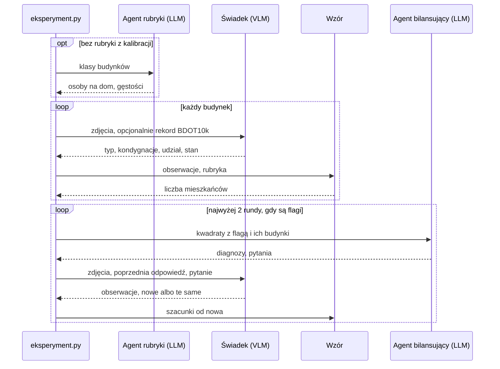

# wroclaw-population-agents

Szacujemy, ile osób mieszka w każdym budynku we Wrocławiu. Zakładamy, że model ruchu będzie dokładniejszy z takim wyliczeniem a spis GUS podaje ludność tylko w kwadratach 125 × 125 m.

Model widzący obrazy (VLM) opisuje budynek ze zdjęć lotniczych z 4 stron świata, a liczbę mieszkańców liczy z tego wzór. Drugi model porównuje wyniki ze spisem i dopytuje pierwszego.

Działamy na jednym arkuszu ortofotomapy: 800 × 500 m, 341 budynków. Pilot na tanim modelu Claude Haiku pokazał, że kod działa, ale nie to, że szacunki są trafne. Docelowo system ma działać na otwartym modelu, np. Qwen, który uruchomimy jak będziemy mieć serwer. Pełne prompty: `docs/architektura.md`, stan prac: `paper/population-estimation.tex`, wykresy: `notebooks/`.


## Instalacja i dane

Python 3.12+: `uv sync` albo `pip install -e .` (wtedy bez `uv run`).

Pobierz ortofotomapę z [geoportal.gov.pl](https://www.geoportal.gov.pl), BDOT10k z [geoportalu Dolnego Śląska](https://geoportal.dolnyslask.pl/imap/#gpmap=gp103), a `Grid_125_XLS.zip` z [ATOM GRID w GUS](https://geo.stat.gov.pl/atom-web/atom/GRID?spatial_dataset_identifier_code=GRID_2021_125m_xls&spatial_dataset_identifier_namespace=GRID), rozpakuj i ułóż tak, bez zmiany nazw:

```text
data/*_6.148.12.04.2_{N,E,S,W}.tif               ok. 80 MB każdy
data/*/BDOT10K/PL.PZGiK.337.0264__OT_BUBD_A.xml  powiat 0264, ok. 320 MB
data/populacja/Grid_125_{1,2}.xlsx
```

## Użycie

Jeden plik `eksperymenty/*.toml` to jeden przebieg. `objetosc` to powierzchnia × wysokość, `objetosc_bdot` to samo, ale 0 dla niemieszkalnych i nieużytkowanych, `wzor` to świadek i wzór, a `petla` dodaje pętlę.

```toml
estymator = "petla"
z_rekordem = true  # czy modele widzą rekord BDOT10k
model = "claude-haiku-5-5"
rubryka = "eksperymenty/rubryki/nsp2021_bez_arkusza.toml"  # albo "llm": agent rubryki
[budynki]
wszystkie = true   # albo kwadraty = 3, albo liczba = 40
```

```bash
uv run python -m agenci.eksperyment eksperymenty/arkusz_haiku.toml --na-sucho  # bez API i zapisu
ANTHROPIC_API_KEY=... uv run python -m agenci.eksperyment eksperymenty/arkusz_haiku.toml
uv run python -m agenci.ewaluacja   # porównanie przebiegów
uv run python -m agenci.kalibracja  # rubryka z NSP 2021
uv run pytest
```

Wyniki trafiają do `wyniki/eksperymenty/`: `<przebieg>.csv` (jeden wiersz na budynek), `__dialog.csv` (rozmowa agentów), `__bilans.csv` (kwadraty po rundach). Odpowiedzi modeli zostają w `wyniki/eksperymenty.sqlite`, więc powtórka jest darmowa, chyba że zmieni się prompt. Katalogu `wyniki/` nie ma w gicie.

## Jak wyglądają dane

| Źródło | Co to jest | Czego używamy |
| --- | --- | --- |
| Ortofotomapa skośna | Cztery pliki TIF: ten sam arkusz sfotografowany pod kątem z czterech stron, piksel 5 cm | obrazy dla modelu |
| BDOT10k, warstwa `OT_BUBD_A` | Państwowa baza budynków | obrys (stąd powierzchnia), funkcja, kondygnacje, stan |
| OpenStreetMap | Otwarta mapa, pobiera się sama | wysokość budynku, gdy jest |
| NSP 2021 | Spis powszechny: liczba osób w każdym zamieszkanym kwadracie | kalibracja, flagi, ocena |

Budynek należy do kwadratu, w którym leży jego środek. Arkusz ucina kwadraty na brzegach, więc ze spisem porównujemy tylko 15 kompletnych, których wszystkie budynki mieszkalne leżą na arkuszu.

Zdjęcia mają współrzędne, więc obrys z BDOT10k wskazuje podstawę budynku, a dach jest przesunięty od kamery o 0,85 × wysokość (z OSM, inaczej 3,3 m na kondygnację + 2 m).

## Jeden budynek od początku do końca

Rekord BDOT10k: 440 m², 5 kondygnacji, budynek wielorodzinny z apteką, eksploatowany. Kod wycina cztery widoki (budynek z obrysem podstawy i dachu) i fasady (ściana zwrócona do kamery, wyprostowana do prostokąta).

Świadek, czyli VLM, ogląda te obrazy i zwraca:

```text
typ: kamienica, kondygnacje: 5, udział mieszkalny: 0,85, stan: użytkowany, pewność: 0,8
"Apteka w BDOT wskazuje na usługi na parterze, dlatego przyjmuję około 0,85 powierzchni jako mieszkalną."
```

Typ i kondygnacje wyznaczają klasę budynku, a rubryka podaje jej gęstość. Kamienica lub blok do 5 kondygnacji ma 2,05 mieszkańca na 100 m² powierzchni wszystkich kondygnacji, a wyższy 1,38:

```text
440 m² × 5 kondygnacji × 0,85 × 2,05 / 100 = 38 mieszkańców
```

Dom jednorodzinny to osoby na dom × udział. Budynek niemieszkalny albo nieużytkowany ma 0. Kondygnacje bierzemy z BDOT10k, a od świadka tylko wtedy, gdy baza ich nie ma, więc obraz działa na wynik przez typ, udział i stan.

Rubryka to cztery liczby: osoby na dom i gęstości trzech klas (do 5 kondygnacji, wyższy, zamieszkanie zbiorowe). Daje je kalibracja na spisie (`kalibracja.py`) albo agent rubryki, czyli LLM, który podaje je z własnej wiedzy.

## Jak działa pętla

Kod sumuje szacunki w kwadratach, skaluje je tak, by suma całego obszaru równała się spisowi, i stawia flagę, gdy kwadrat różni się od spisu ponad 1,5 raza i o co najmniej 25 osób. Ta skala nie zmienia szacunków budynków.

Agent bilansujący (LLM, bez zdjęć) dostaje kwadraty z flagą i opisy ich budynków, stawia diagnozę i pisze pytania do świadka. Kod przepuszcza tylko pytania o budynki z kwadratów z flagą albo sprzeczne z rekordem, jedno na budynek w rundzie, bez powtórek, najwyżej 20. Wycina też cyfry, żeby świadek nie poznał liczb ze spisu.



Świadek ma zmienić odpowiedź tylko wtedy, gdy uzasadnia to obraz. Wynik końcowy to kolumna `mieszkancy`, a stan sprzed pętli to `mieszkancy_r0`.

## Co sprawdzamy

Dla pojedynczego budynku nie mamy prawdziwej liczby mieszkańców, więc oceniamy pośrednio.

Sumy w kompletnych kwadratach porównujemy ze spisem. Spearman mówi, czy kolejność kwadratów się zgadza, a WAPE, jaką część ludzi trzeba by przesunąć między kwadratami. Przed WAPE każdą serię skalujemy do sumy spisu, więc oceniamy rozkład i da się porównać objętość w m³ z osobami. Punktem odniesienia jest `objetosc_bdot`, bo działa bez modelu. Wariant jest lepszy, gdy przedział różnicy względem niej (bootstrap po kwadratach) nie obejmuje zera.

Opis budynku porównujemy z BDOT10k: F1 dla pytania "czy ktoś tu mieszka" i błąd kondygnacji. Ma to sens tylko przy `z_rekordem = false`, bo inaczej model widzi odpowiedź.

Czy spis nie zasila sam siebie? Kalibracja ustala gęstości na ok. 5,6 tys. kwadratów poza arkuszem, więc 15 kwadratów arkusza jest poza próbą. Agent w pętli widział jednak ich sumy, dlatego oceniamy `mieszkancy_r0`, choć wynikiem końcowym jest `mieszkancy`. Czy pętla pomaga, jeszcze nie wiemy: uczciwy test to zgodność z BDOT10k przed pętlą i po niej przy `z_rekordem = false`, a taki przebieg mamy tylko na 25 budynkach.

Pilot `arkusz_haiku` (rekord widoczny, 15 kwadratów, 0,29 USD): Haiku przed pętlą ma Spearmana 0,89 [0,64; 0,98] i WAPE 0,16, a objętość z BDOT10k 0,85 [0,52; 0,98] i 0,21. Różnica Haiku i objętości to +0,04 [-0,09; +0,23] w Spearmanie i -0,05 [-0,15; +0,04] w WAPE. Oba przedziały obejmują zero, a prawie cały zysk w WAPE to jeden kwadrat z akademikiem, więc przewagi nie mamy. Przed skalowaniem szacunek to 3 974 osoby wobec 5 476 w spisie. Nie wiemy też, czy pomagają obrazy, bo świadka bez obrazów jeszcze nie ma.

