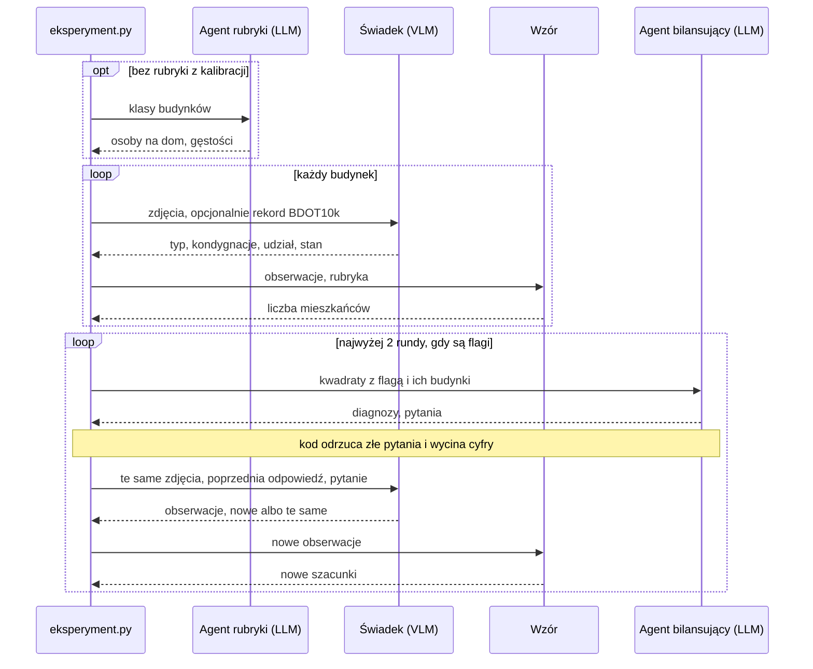

# wroclaw-population-agents

Szacujemy, ile osób mieszka w każdym budynku we Wrocławiu. Modele ruchu potrzebują tej liczby dla pojedynczych budynków, a spis powszechny podaje ludność tylko w kwadratach 125 × 125 m.

Model widzący obrazy (VLM) opisuje budynek ze zdjęć lotniczych, a liczbę mieszkańców liczy z tego opisu zwykły wzór. Drugi model porównuje wyniki ze spisem i przy rozjeździe dopytuje pierwszego.

Działa jeden arkusz ortofotomapy: 800 × 500 m, 341 budynków. Pilot na tanim modelu Claude Haiku pokazał, że kod działa od początku do końca, ale nie to, że szacunki są trafne. Docelowo system ma działać na otwartym modelu, np. Qwen, którego jeszcze nie uruchamialiśmy. Pełne prompty: `docs/architektura.md`, stan prac: `paper/population-estimation.tex`.

## Jak wyglądają dane

| Źródło | Co to jest | Czego używamy |
| --- | --- | --- |
| Ortofotomapa skośna | Cztery pliki TIF: ten sam arkusz sfotografowany pod kątem z północy, wschodu, południa i zachodu, piksel 5 cm | obrazy dla modelu |
| BDOT10k, warstwa `OT_BUBD_A` | Państwowa baza budynków, jeden rekord na budynek | obrys (stąd powierzchnia), funkcja, kondygnacje, stan |
| OpenStreetMap | Otwarta mapa, pobiera się sama | zmierzona wysokość, gdy jest; tylko do ustawienia kadru |
| NSP 2021 | Spis powszechny: liczba osób w każdym zamieszkanym kwadracie | kalibracja, flagi, ocena |

Budynek należy do kwadratu, w którym leży jego środek. Arkusz ucina kwadraty na brzegach, więc ze spisem porównujemy tylko 15 kwadratów kompletnych, czyli takich, których wszystkie budynki mieszkalne leżą na arkuszu.

## Jeden budynek od początku do końca

Rekord BDOT10k: 440 m², 5 kondygnacji, budynek wielorodzinny z apteką, eksploatowany. Z arkuszy kod wycina cztery widoki (cały budynek z obrysem podstawy i dachu) i fasady (ściana zwrócona do kamery, wyprostowana do prostokąta).

Świadek, czyli VLM, ogląda te obrazy i zwraca:

```text
typ: kamienica, kondygnacje: 5, udział mieszkalny: 0,85, stan: użytkowany, pewność: 0,8
"Apteka w BDOT wskazuje na usługi na parterze, dlatego przyjmuję około 0,85 powierzchni jako mieszkalną."
```

Typ wyznacza klasę budynku, a rubryka podaje gęstość tej klasy: 2,05 mieszkańca na 100 m² powierzchni wszystkich kondygnacji. Stąd dzielenie przez 100:

```text
440 m² × 5 kondygnacji × 0,85 × 2,05 / 100 = 38 mieszkańców
```

Dom jednorodzinny to osoby na dom × udział. Budynek niemieszkalny albo nieużytkowany ma 0. Kondygnacje bierzemy z BDOT10k, a od świadka tylko wtedy, gdy baza ich nie ma, więc obraz działa na wynik przez typ, udział i stan.

Rubryka to cztery liczby: osoby na dom i gęstości trzech klas (wielorodzinny do 5 kondygnacji, wyższy, zamieszkanie zbiorowe). Daje je kalibracja na spisie (`kalibracja.py`, kwadraty spoza arkusza) albo agent rubryki, czyli LLM, który podaje je z własnej wiedzy i spisu nie widzi. Wybór jest w pliku TOML.

## Jak działa pętla

Po policzeniu wszystkich budynków kod sumuje szacunki w kwadratach, skaluje je tak, by suma całego obszaru równała się spisowi, i stawia flagę, gdy kwadrat różni się od spisu ponad 1,5 raza i o co najmniej 25 osób. Ta skala służy tylko do porównania.

Agent bilansujący (LLM, bez zdjęć) dostaje kwadraty z flagą i opisy ich budynków, stawia diagnozę i pisze pytania do świadka. Kod przepuszcza tylko pytania o budynki z kwadratów z flagą albo sprzeczne z rekordem, jedno na budynek w rundzie, bez powtórek, najwyżej 20. Wycina też cyfry, żeby świadek nie poznał liczb ze spisu i się do nich nie dopasował.



Świadek zmienia odpowiedź tylko wtedy, gdy uzasadnia to obraz. Modele nie rozmawiają bezpośrednio: każda wiadomość przechodzi przez kod (`petla.py`). Wynik końcowy to kolumna `mieszkancy`, a stan sprzed pętli to `mieszkancy_r0`.

## Co sprawdzamy

Dla pojedynczego budynku nie mamy prawdziwej liczby mieszkańców, więc oceniamy pośrednio.

Sumy w kompletnych kwadratach porównujemy ze spisem. Spearman mówi, czy kolejność kwadratów się zgadza, a WAPE, jaką część ludzi trzeba by przesunąć między kwadratami. Punktem odniesienia jest `objetosc_bdot`, czyli sama objętość budynków mieszkalnych, bez modelu. Stałego progu nie ma: dopóki przedział różnicy względem niej obejmuje zero, przewaga nie jest rozstrzygnięta.

Opis budynku porównujemy z BDOT10k: F1 dla pytania "czy ktoś tu mieszka" i błąd kondygnacji. Ma to sens tylko przy `z_rekordem = false`, bo inaczej model widzi odpowiedź w prompcie.

Czy spis nie zasila sam siebie? Kalibracja ustala jedną gęstość na klasę z ok. 5,6 tys. kwadratów poza arkuszem, więc na arkuszu ocena jest poza próbą. Pętla widzi sumy z tych kwadratów, dlatego oceniamy `mieszkancy_r0`, a szacunków budynków nigdy nie skalujemy do spisu.

| Pilot, 15 kwadratów | Spearman [95%] | WAPE [95%] |
| --- | --- | --- |
| objętość z BDOT10k | 0,85 [0,52; 0,98] | 0,21 [0,11; 0,32] |
| Haiku przed pętlą | 0,89 [0,64; 0,98] | 0,16 [0,10; 0,22] |

Przedziały się pokrywają, a prawie cały zysk w WAPE to jeden kwadrat z akademikiem, więc przewagi nie mamy. Nie wiemy też, czy pomagają obrazy, bo wariantów bez nich jeszcze nie zbudowaliśmy. Cały arkusz kosztował 0,29 USD.

## Instalacja i dane

Python 3.12+: `uv sync` albo `pip install -e .` (wtedy bez `uv run`). Notatniki trzymamy z wynikami, więc stary filtr wyłącz: `nbstripout --uninstall`.

Danych nie ma w gicie. Pobierz ortofotomapę z [geoportal.gov.pl](https://www.geoportal.gov.pl), BDOT10k z [geoportalu Dolnego Śląska](https://geoportal.dolnyslask.pl/imap/#gpmap=gp103), a `Grid_125_XLS.zip` z [ATOM GRID w GUS](https://geo.stat.gov.pl/atom-web/atom/GRID?spatial_dataset_identifier_code=GRID_2021_125m_xls&spatial_dataset_identifier_namespace=GRID), rozpakuj i ułóż tak, bez zmiany nazw:

```text
data/*_6.148.12.04.2_{N,E,S,W}.tif                 ok. 80 MB każdy
data/*/BDOT10K/PL.PZGiK.337.0264__OT_BUBD_A.xml    powiat 0264, ok. 320 MB
data/populacja/Grid_125_{1,2}.xlsx
```

## Użycie

Jeden plik `eksperymenty/*.toml` to jeden przebieg:

```toml
estymator = "petla"          # albo wzor, objetosc, objetosc_bdot
z_rekordem = true            # czy modele widzą rekord BDOT10k
model = "claude-haiku-5-5"
rubryka = "eksperymenty/rubryki/nsp2021_bez_arkusza.toml"  # albo "llm": agent rubryki
[budynki]
wszystkie = true             # albo kwadraty = 3, albo liczba = 40
```

```bash
uv run python -m agenci.eksperyment eksperymenty/arkusz_haiku.toml --na-sucho  # bez API i zapisu
ANTHROPIC_API_KEY=... uv run python -m agenci.eksperyment eksperymenty/arkusz_haiku.toml
uv run python -m agenci.ewaluacja   # porównanie przebiegów
uv run python -m agenci.kalibracja  # rubryka z NSP 2021
uv run pytest
```

Wyniki trafiają do `wyniki/eksperymenty/`: `<przebieg>.csv` (jeden wiersz na budynek), `__dialog.csv` (rozmowa agentów), `__bilans.csv` (kwadraty po rundach). Odpowiedzi modeli zostają w `wyniki/eksperymenty.sqlite`, więc powtórka przebiegu jest darmowa, a zmiana promptu to nowe, płatne wywołania. Katalogu `wyniki/` nie ma w gicie.

Notatniki: `proof_of_concept` (przegląd), `wyniki` (cały arkusz), `demo_ortofotomapa_skosna`.
