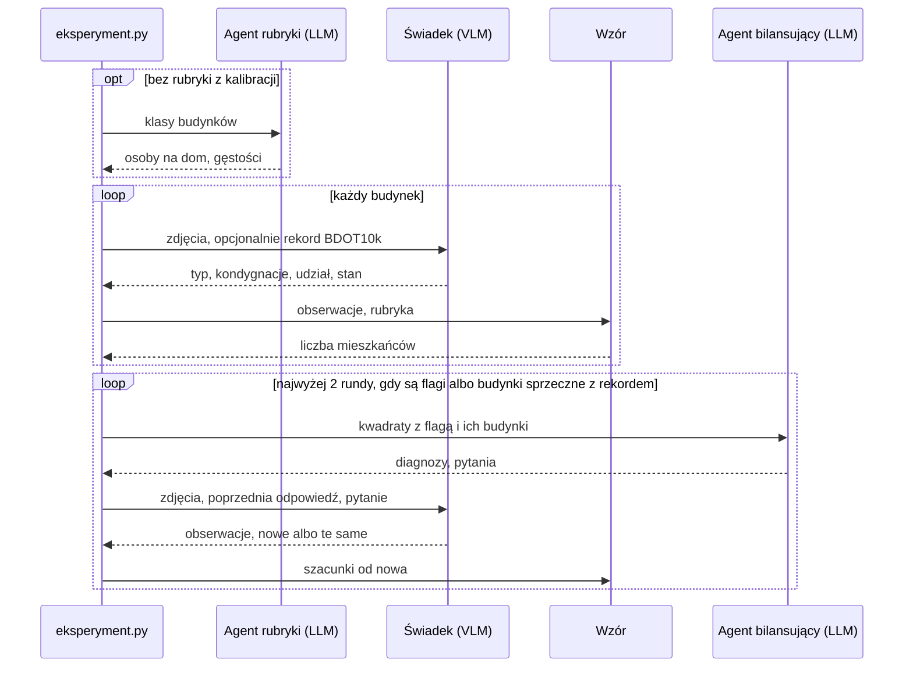

# wroclaw-population-agents

Szacujemy, ile osób mieszka w każdym budynku we Wrocławiu. Modele ruchu potrzebują jej dla pojedynczych budynków, a spis podaje ludność tylko w kwadratach 125 × 125 m.

Model widzący obrazy (VLM) opisuje budynek ze zdjęć lotniczych, a liczbę mieszkańców liczy z tego zwykły wzór. Drugi agent, oparty na tym samym modelu, porównuje wyniki ze spisem i dopytuje pierwszego.

Działa jeden arkusz ortofotomapy: 800 × 500 m, 341 budynków. Pilot na tanim modelu Claude Haiku pokazał, że kod działa, ale nie to, że szacunki są trafne. Docelowo system ma działać na otwartym modelu, np. Qwen, którego jeszcze nie uruchamialiśmy. Architektura: `docs/architektura.md`, pełne prompty: `src/agenci/`, stan prac i prompty po angielsku: `paper/population-estimation.tex`, wykresy: `notebooks/`.


## Instalacja i dane

Python 3.12+: `uv sync` albo `pip install -e .` (wtedy bez `uv run`). Notatniki są w gicie z wynikami komórek, więc nie używaj `nbstripout`.

Pobierz ortofotomapę z [geoportal.gov.pl](https://www.geoportal.gov.pl), BDOT10k z [geoportalu Dolnego Śląska](https://geoportal.dolnyslask.pl/imap/#gpmap=gp103), a `Grid_125_XLS.zip` z [ATOM GRID w GUS](https://geo.stat.gov.pl/atom-web/atom/GRID?spatial_dataset_identifier_code=GRID_2021_125m_xls&spatial_dataset_identifier_namespace=GRID), rozpakuj i ułóż tak, bez zmiany nazw:

```text
data/*_6.148.12.04.2_{N,E,S,W}.tif               ok. 80 MB każdy
data/*/BDOT10K/PL.PZGiK.337.0264__OT_BUBD_A.xml  powiat 0264, ok. 320 MB
data/populacja/Grid_125_{1,2}.xlsx
```

## Użycie

Jeden plik `eksperymenty/*.toml` to jeden przebieg. `objetosc` to powierzchnia × wysokość, `objetosc_bdot` to samo, ale 0 dla niemieszkalnych i nieużytkowanych, `wzor` to świadek i wzór, a `petla` dodaje pętlę.

```toml
estymator = "petla"
z_rekordem = true  # czy modele widzą rekord BDOT10k
model = "claude-haiku-5-5"
rubryka = "eksperymenty/rubryki/nsp2021_bez_arkusza.toml"  # albo "llm": agent rubryki
[budynki]
wszystkie = true   # albo kwadraty = 3, albo liczba = 40
```

```bash
uv run python -m agenci.eksperyment eksperymenty/arkusz_haiku.toml --na-sucho  # bez API i zapisu
ANTHROPIC_API_KEY=... uv run python -m agenci.eksperyment eksperymenty/arkusz_haiku.toml
uv run python -m agenci.ewaluacja   # porównanie przebiegów
uv run python -m agenci.kalibracja  # rubryka z NSP 2021
uv run pytest
```

Wyniki trafiają do `wyniki/eksperymenty/`: `<przebieg>.csv` (jeden wiersz na budynek), `__dialog.csv` (rozmowa agentów), `__bilans.csv` (kwadraty po rundach). Odpowiedzi modeli zostają w `wyniki/eksperymenty.sqlite`, więc powtórka jest darmowa, a zmiana promptu kosztuje. Katalogu `wyniki/` nie ma w gicie.

## Jak wyglądają dane

| Źródło | Co to jest | Czego używamy |
| --- | --- | --- |
| Ortofotomapa skośna | Cztery pliki TIF: ten sam arkusz sfotografowany pod kątem z czterech stron, piksel 5 cm | obrazy dla modelu |
| BDOT10k, warstwa `OT_BUBD_A` | Państwowa baza budynków | obrys (stąd powierzchnia), funkcja, kondygnacje, stan |
| OpenStreetMap | Otwarta mapa, pobiera się sama | wysokość budynku, gdy jest |
| NSP 2021 | Spis powszechny: liczba osób w każdym zamieszkanym kwadracie | kalibracja, flagi, ocena |

Budynek należy do kwadratu, w którym leży jego środek. Arkusz ucina kwadraty na brzegach, więc ze spisem porównujemy tylko 15 kompletnych, których wszystkie budynki mieszkalne leżą na arkuszu.

Zdjęcia mają współrzędne, więc obrys z BDOT10k wskazuje podstawę budynku, a dach jest przesunięty od kamery o 0,85 × wysokość (z OSM, inaczej 3,3 m na kondygnację + 2 m).

## Jeden budynek od początku do końca

Prawdziwy przebieg `arkusz_haiku` dla jednego budynku, środkowego segmentu długiego bloku. Świadek najpierw go nie rozpoznał, kod wykrył sprzeczność z BDOT10k, agent dopytał, a szacunek zmienił się z 0 na 13 osób.


Wypowiedzi modeli są dosłowne (tabela `wywolania` w `wyniki/eksperymenty.sqlite`, wiersze 6894, 7428, 7432 i 7435), a wycinki mają te same hashe co w logu. Skrócone są tylko polecenia systemowe; pełne są w `src/agenci/`.

### Co jest deterministyczne

Model działa tylko w krokach 5, 10, 12 i 15. Świadek ocenia budynek, a agent wybiera, o co zapytać. Całą resztę liczy kod: te same odpowiedzi modeli zawsze dają ten sam wynik, a powtórka przebiegu bierze je z SQLite. Żaden model nie podaje liczby mieszkańców, bo odpowiedź świadka nie ma takiego pola, a agent może tylko zadać pytanie.

### Wzór

```text
dom:         mieszkańcy = osoby_na_dom × udział
mieszkania:  mieszkańcy = powierzchnia × kondygnacje × udział × gęstość[klasa] / 100
pozostałe:   mieszkańcy = 0
```

| Składnik | Skąd | W przykładzie |
| --- | --- | --- |
| powierzchnia | obrys z BDOT10k | 145,1 m² |
| kondygnacje | BDOT10k; gdy brak, świadek; gdy też brak, wysokość / 3 | 5 |
| udział mieszkalny | świadek | 0,9 |
| klasa | typ od świadka i kondygnacje | `blok_prl`, 5 kondygnacji: do 5 kondygnacji |
| gęstość albo osoby na dom | rubryka | 2,0474 |

`dom_jednorodzinny` i `szeregowiec` liczymy jako dom, `kamienica`, `blok_prl` i `blok_nowy` jako mieszkania, a `zbiorowy` ma własną gęstość. `uslugi`, `przemysl`, `garaz` i `inny` dają 0, tak samo jak stan inny niż `uzytkowany`. Wyjątek: `inny` przy rekordzie mieszkalnym i eksploatowanym dostaje klasę z rekordu. Obraz działa więc na wynik przez typ, udział i stan.

Rubryka to cztery liczby z kalibracji na spisie (`kalibracja.py`). Może je też podać agent rubryki, czyli LLM z własnej wiedzy, ale w tym przebiegu nie działał. Tak wygląda jeden wiersz regresji na kwadracie z przykładu, który do dopasowania nie wszedł: 0 domów, 14 561 m² budynków niskich i 2 587 m² wysokich daje 2,0474 × 145,61 + 1,3787 × 25,87 = 334 osoby wobec 486 w spisie.

### Przyjęte liczby

| Liczba | Wartość | Skąd | Do czego |
| --- | --- | --- | --- |
| osoby na dom | 3,2123 | kalibracja | wzór |
| gęstość: wielorodzinny do 5 kondygnacji | 2,0474 na 100 m² | kalibracja | wzór |
| gęstość: wielorodzinny powyżej 5 | 1,3787 na 100 m² | kalibracja | wzór |
| gęstość: zbiorowy | 0,2194 na 100 m² | kalibracja | wzór |
| próg budynku wysokiego | 5 kondygnacji | Pirowski i Bartos 2018 | klasa we wzorze |
| wysokość bez OSM | 3,3 m × kondygnacje + 2 m, a bez kondygnacji 8 m | założenie | wycinki, baseline objętości |
| przesunięcie dachu | 0,85 × wysokość | sprawdzone wzrokowo, kamera ok. 40° od pionu | obrys dachu, fasady |
| obraz dla modelu | do 768 px | limit | karta budynku |
| flaga kwadratu | ponad 1,5 raza i co najmniej 25 osób | symulacja: przy idealnym świadku 1 flaga na 14 kwadratów | bilans |
| rundy pętli | 2 | Du i in. 2024 | pętla |
| pytania w rundzie | 20 | limit kosztu | pętla |

Udział mieszkalny nie jest przyjętą liczbą, bo podaje go świadek osobno dla każdego budynku.

### Czego ten przykład nie dowodzi

- Nie wiemy, czy 13 osób to prawda, bo dla pojedynczych budynków nie mamy z czym porównać. Stykające się segmenty o podobnej powierzchni świadek od razu opisał jako `blok_prl` i dostały 12,15 oraz 13,31 osoby, więc wynik pasuje do bloku, ale to nie jest dowód.
- Poziom jest zaniżony: w 15 kwadratach szacunek to 3 974 osoby wobec 5 476 w spisie. Część powodu leży we wzorze, bo gęstości z kalibracji zawierają już przeciętną część niemieszkalną, a wzór mnoży je jeszcze przez udział. Dlatego porównujemy rozkład między kwadratami, a nie sumy.
- Świadek widział rekord (`z_rekordem = true`), a obie jego odpowiedzi powołują się na BDOT10k. Nie wiemy więc, czy poprawkę wymusił widok S, czy sam rekord.
- Dobry wniosek nie znaczy dobrego uzasadnienia: „niższe skrzydło” w drugiej odpowiedzi to w rzeczywistości dach tego samego budynku.

## Jak działa pętla

Kod sumuje szacunki w kwadratach, skaluje je tak, by suma całego obszaru równała się spisowi, i stawia flagę, gdy kwadrat różni się od spisu ponad 1,5 raza i o co najmniej 25 osób. Ta skala nie zmienia szacunków budynków.

Agent bilansujący (LLM, bez zdjęć) dostaje kwadraty z flagą i opisy ich budynków, stawia diagnozę i pisze pytania do świadka. Kod przepuszcza tylko pytania o budynki z kwadratów z flagą albo sprzeczne z rekordem, jedno na budynek w rundzie, bez powtórek, najwyżej 20. Wycina też cyfry, żeby świadek nie poznał liczb ze spisu.



Świadek ma zmienić odpowiedź tylko wtedy, gdy uzasadnia to obraz. Wynik końcowy to kolumna `mieszkancy`, a stan sprzed pętli to `mieszkancy_r0`.

## Co sprawdzamy

Dla pojedynczego budynku nie mamy prawdziwej liczby mieszkańców, więc oceniamy pośrednio.

Sumy w kompletnych kwadratach porównujemy ze spisem. Spearman mówi, czy kolejność kwadratów się zgadza, a WAPE, jaką część ludzi trzeba by przesunąć między kwadratami. Przed WAPE każdą serię skalujemy do sumy spisu, więc oceniamy rozkład i da się porównać objętość w m³ z osobami. Punktem odniesienia jest `objetosc_bdot`, bo działa bez modelu. Wariant jest lepszy, gdy przedział różnicy względem niej (bootstrap po kwadratach) nie obejmuje zera.

Opis budynku porównujemy z BDOT10k: F1 dla pytania "czy ktoś tu mieszka" i błąd kondygnacji. Ma to sens tylko przy `z_rekordem = false`, bo inaczej model widzi odpowiedź.

Czy spis nie zasila sam siebie? Kalibracja ustala gęstości na ok. 5,6 tys. kwadratów poza arkuszem, więc 15 kwadratów arkusza jest poza próbą. Agent w pętli widział jednak ich sumy, dlatego oceniamy `mieszkancy_r0`, choć wynikiem końcowym jest `mieszkancy`. Czy pętla pomaga, jeszcze nie wiemy: uczciwy test to zgodność z BDOT10k przed pętlą i po niej przy `z_rekordem = false`, a taki przebieg mamy tylko na 25 budynkach.

Pilot `arkusz_haiku` (rekord widoczny, 15 kwadratów, 0,29 USD): Haiku przed pętlą ma Spearmana 0,89 [0,64; 0,98] i WAPE 0,16, a objętość z BDOT10k 0,85 [0,52; 0,98] i 0,21. Różnica Haiku i objętości to +0,04 [-0,09; +0,23] w Spearmanie i -0,05 [-0,15; +0,04] w WAPE. Oba przedziały obejmują zero, a prawie cały zysk w WAPE to jeden kwadrat z akademikiem, więc przewagi nie mamy. Przed skalowaniem szacunek to 3 974 osoby wobec 5 476 w spisie. Nie wiemy też, czy pomagają obrazy, bo świadka bez obrazów jeszcze nie ma.

