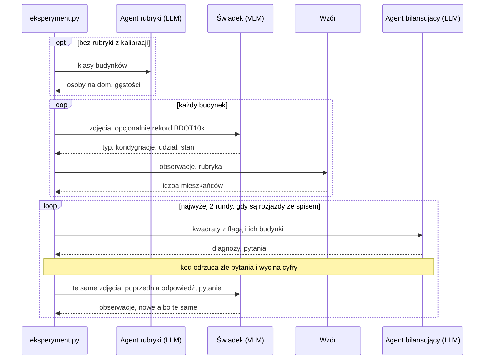

# wroclaw-population-agents

System agentów VLM szacujący liczbę mieszkańców budynków we Wrocławiu ze zdjęć lotniczych i danych przestrzennych. Działa jeden arkusz, sprawdzony pilotem na tanim modelu Haiku; docelowo otwarty model, np. Qwen (jeszcze nieuruchomiony). Prompty i szczegóły: `docs/architektura.md`, stan prac: `paper/population-estimation.tex`.

## Jak to działa

Żaden model nie podaje liczby mieszkańców: model opisuje budynek, a liczy wzór. Spis służy do kalibracji i wskazywania rozjazdów, ale szacunków nigdy się do niego nie skaluje.

1. **Karta** (`karta.py`): rekord BDOT10k, widoki z czterech stron, fasady.
2. **Rubryka** (`kalibracja.py` albo agent rubryki): osoby na dom, gęstości klas.
3. **Świadek wizualny** (`swiadkowie.py`): typ, kondygnacje, udział mieszkalny, stan.
4. **Wzór** (`estymatory.py`): powierzchnia × kondygnacje z BDOT10k × udział × gęstość / 100.
5. **Pętla** (`petla.py`): agent bilansujący widzi spis, ale nie zdjęcia, i dopytuje świadka o rozjazdy.



Odpowiedzi modeli są w pamięci (`wyniki/eksperymenty.sqlite`): powtórka przebiegu jest darmowa, a zmiana promptu to nowe, płatne wywołania.

## Instalacja

Python 3.12+: `uv sync` albo `pip install -e .` (wtedy bez `uv run`). Notatniki trzymamy z wynikami, więc stary filtr wyłącz: `nbstripout --uninstall`.

## Dane

Nie trafiają do gita. Wrzuć je do `data/` bez zmiany nazw; obrysy z OSM pobiorą się same.

```text
*_6.148.12.04.2_{N,E,S,W}.tif               ortofotomapa skośna, 2025, ok. 80 MB każdy
*/BDOT10K/PL.PZGiK.337.0264__OT_BUBD_A.xml  BDOT10k, powiat 0264, ok. 320 MB
populacja/Grid_125_{1,2}.xlsx               NSP 2021, siatka 125 m, Grid_125_XLS.zip
```

Źródła: [geoportal.gov.pl](https://www.geoportal.gov.pl), [geoportal Dolnego Śląska](https://geoportal.dolnyslask.pl/imap/#gpmap=gp103), [ATOM GRID w GUS](https://geo.stat.gov.pl/atom-web/atom/GRID?spatial_dataset_identifier_code=GRID_2021_125m_xls&spatial_dataset_identifier_namespace=GRID).

## Użycie

Plik `eksperymenty/*.toml` to jeden przebieg; wyniki idą do `wyniki/eksperymenty/`.

```bash
uv run python -m agenci.eksperyment eksperymenty/arkusz_haiku.toml --na-sucho  # bez API i zapisu
ANTHROPIC_API_KEY=... uv run python -m agenci.eksperyment eksperymenty/arkusz_haiku.toml
uv run python -m agenci.ewaluacja   # porównanie przebiegów
uv run python -m agenci.kalibracja  # rubryka z NSP 2021
uv run pytest
```

Notatniki: `proof_of_concept` (przegląd), `wyniki` (cały arkusz), `demo_ortofotomapa_skosna`.
