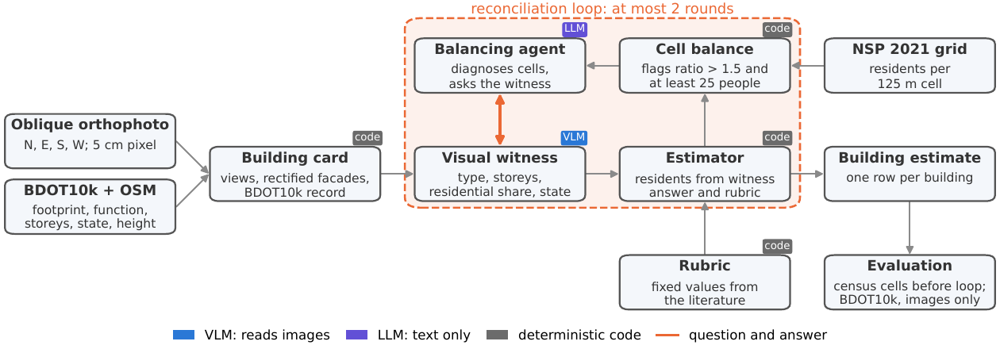

# Architektura

VLM (model, który widzi obrazy) opisuje budynek, a liczbę mieszkańców liczy wzór. LLM to model, który dostaje sam tekst. Spis NSP 2021 wpływa na wynik tylko przez pytania agenta bilansującego. Wzór nie potrzebuje sumy kwadratu, więc działa też dla osiedli oddanych po spisie.

*Estimator* to na rysunku wzór, nie pole `estymator` z TOML. Rysunek upraszcza trzy rzeczy: pierwsze przejście świadka jest przed opcjonalną pętlą, strzałka agent-świadek biegnie przez filtr w kodzie, a o budynek można pytać też bez flagi. Jeden budynek krok po kroku, pochodzenie rubryki i miary oceny (Spearman, WAPE, F1, bootstrap) opisuje README.

## Dane w kodzie

| Postać | Co zawiera |
| --- | --- |
| Budynek | wiersz GeoDataFrame o id `lokalnyId` z BDOT10k: obrys, `funkcja`, `kategoria` (stan), `kondygnacje`, `h` (wysokość) |
| Kwadrat | kod `CRS3035RES125mN3135000E4814125` (współrzędne narożnika), `ludnosc` |
| Karta | pola rekordu oraz `widoki` i `fasady`: kierunek → obraz RGB, najwyżej 768 px |
| Obserwacja | JSON świadka: `typ`, `kondygnacje`, `udzial_mieszkalny` (0-1), `stan` (`uzytkowany`, `w_budowie`, `pustostan`), `pewnosc`, `uzasadnienie` |

Model dostaje do 8 obrazów, każdy z podpisem, np. `Widok N: kamera patrzy na północ, widać ścianę południową.` Rekord to powierzchnia, funkcje, kondygnacje, stan i wysokość z OSM. Podstawa budynku leży na gruncie, więc bywa przykryta dachem sąsiada.

| Wynik w `wyniki/` | Wiersz | Główne kolumny |
| --- | --- | --- |
| `eksperymenty/<przebieg>.csv` | budynek | `budynek`, `mieszkancy` (wynik), `blad` (wyjątek); z modelem też obserwacja i `koszt_usd`; z pętlą też `typ_r0` itd. (przed pętlą), `mieszkancy_r0`, `_r1`, `_r2`, `dopytany`, `zmieniony`, `nowa_zabudowa` |
| `…__bilans.csv` | kwadrat po rundzie | `kod`, `ludnosc`, `szacunek` (po skali), `iloraz`, `flaga`, `runda` (stan po tylu rundach, 0: przed pętlą) |
| `…__dialog.csv` | zdarzenie rozmowy | `runda`, `rodzaj` (`kwadrat`, `pytanie`, `nowa_zabudowa`), `kod`, `diagnoza`, `uzasadnienie`, `budynek`, `atrybut`, `pytanie`, `odpowiedz`, `zmiana`, `mieszkancy_przed`, `_po` |
| `eksperymenty.sqlite` | wywołanie modelu | `rola`, `prompt`, `odpowiedz`, tokeny, koszt, czas |

## Agenci

Agent to jedno bezstanowe wywołanie modelu bez narzędzi, z odpowiedzią w JSON wymuszonym schematem. Stan trzyma kod, a wszystkie role obsługuje jeden `model` z TOML. Wywołania idą przez `llm.Klient`, który zapisuje je w SQLite, więc każda zmiana promptu to nowe, płatne wywołania.

| Agent | Kiedy | Dostaje | Zwraca |
| --- | --- | --- | --- |
| Świadek (VLM) | raz na budynek | obrazy, przy `z_rekordem = true` też rekord | obserwację |
| Agent bilansujący (LLM) | raz w rundzie z kandydatami | kwadraty z flagą (spis, szacunek, obserwacje i szacunki budynków), budynki sprzeczne z rekordem, historię pytań | `kwadraty` (diagnozy), `pytania`, `nowa_zabudowa` |
| Świadek, dopytanie (VLM) | raz na pytanie po filtrze | to co świadek, poprzednią odpowiedź, pytanie | całą obserwację od nowa |

Pełne prompty są w kodzie.

## Pętla

Świadek i wzór przechodzą najpierw raz przez każdy budynek. Przy `estymator = "petla"` rusza potem `petla.uzgodnij`, a każdą wiadomość przekazuje kod. Debaty agentów potrafią zbiec do złej odpowiedzi (Du i in. 2024), więc pętla może zostawić rozjazd ze spisem.

1. `bilans` sumuje szacunki w kompletnych kwadratach i mnoży je przez wspólną skalę, żeby suma równała się spisowi. Skala służy tylko do tego porównania. Flaga to różnica ponad 1,5 raza w dowolną stronę i co najmniej 25 osób.
2. Kandydaci to budynki z kwadratów z flagą oraz, także spoza nich, budynki sprzeczne z rekordem (`sprzeczny`): świadek i BDOT10k różnią się co do tego, czy ktoś tu mieszka.
3. Agent stawia diagnozę (`blad_swiadka`, `nowa_zabudowa`, `rubryka`, `szum_spisu` albo `nieznana`) i wybiera, o co pytać. Diagnozy i lista `nowa_zabudowa` trafiają tylko do zapisu. Brak odpowiedzi to odmowa modelu albo limit tokenów.
4. `wazne_pytania` przepuszcza pytania o kandydatów i o `typ`, `udzial_mieszkalny` albo `stan`, jedno na budynek w rundzie, najwyżej 20 na rundę, bez powtórki pary budynek i atrybut. Cyfry zmienia na `…`, żeby świadek nie poznał liczb ze spisu.
5. Odpowiedź świadka zastępuje poprzednią obserwację, więc pytanie o `typ` może zmienić też udział.
6. Wzór liczy od nowa wszystkie budynki. Tylko tak zmienia się szacunek.

Skutki `z_rekordem` (ocena kolista sprawdza model danymi, które już widział):

| | `true` | `false` |
| --- | --- | --- |
| Świadek i agent widzą rekord | tak | nie |
| Kandydaci ze sprzeczności | tak | nie |
| Typ `inny` | klasa z rekordu, jeśli zamieszkany | 0 |
| F1 względem BDOT10k | kolisty | uczciwy |

## Klasy i rubryka

Rubryka to stałe w `estymatory.py`.

| Klasa (`estymatory.klasa`) | Typ od świadka | Rubryka | Źródło |
| --- | --- | --- | --- |
| `dom` | `dom_jednorodzinny`, `szeregowiec` | `OSOBY_NA_DOM` = 2,88 osoby na budynek | Pirowski i Bartos 2018, tab. 1, wariant 3; Pirowski i Szypuła 2024 |
| `wielorodzinny` | `kamienica`, `blok_prl`, `blok_nowy` | `M2_NA_OSOBE` = 37,08 m² na osobę | jak wyżej |
| `zbiorowy` | `zbiorowy` | `M2_NA_OSOBE` = 31 m² na miejsce | College Housing Report 2014, tab. 1 |
| brak, 0 osób | `uslugi`, `przemysl`, `garaz`, `inny` (wyjątek wyżej) | | |

Stan inny niż `uzytkowany` też daje 0. Powierzchnia i kondygnacje pochodzą z BDOT10k także przy `z_rekordem = false`. `pewnosc` czyta tylko agent bilansujący.

## Gdzie co jest w kodzie

| Plik (domyślnie w `src/agenci/`) | Co tam jest, co tu zmienisz |
| --- | --- |
| `src/ortofoto/` | `arkusze.py`: TIF-y; `budynki.py`: BDOT10k + OSM; `wycinki.py`: wycinki, fasady, przesunięcie dachu `K` |
| `karta.py` | `Karta`, kolory obrysów |
| `llm.py` | `Klient`: dostawca modelu, pamięć odpowiedzi, `CENY` |
| `swiadkowie.py` | prompt i schemat świadka, `TYPY`, `dopytaj_swiadka` |
| `estymatory.py` | `ze_wzoru`, `klasa`, rubryka (`OSOBY_NA_DOM`, `M2_NA_OSOBE`), baseline'y: tu dopisujesz nowy (funkcja karta → liczba) |
| `statystyka.py` | NSP 2021 i kwadraty |
| `petla.py` | `bilans`, `sprzeczny`, `wazne_pytania`, `uzgodnij`, prompt agenta; `PROG_ILORAZU` 1,5, `MIN_OSOB` 25, `RUNDY` 2, `MAX_PYTAN` 20 |
| `eksperyment.py` | `Konfiguracja` (pola TOML), rejestr baseline'ów `BASELINE` |
| `ewaluacja.py` | zgodność z BDOT10k, sumy w kwadratach, bootstrap |
