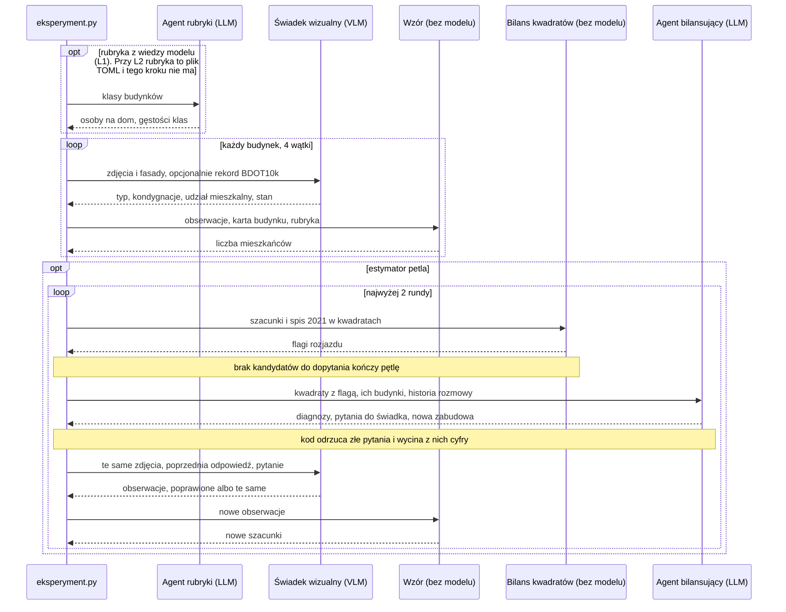

# Architektura

System szacuje liczbę mieszkańców każdego budynku na arkuszu ortofotomapy skośnej Wrocławia.

**Najważniejsza decyzja: żaden model nie podaje liczby mieszkańców.** Model opisuje budynek (typ, udział mieszkalny, stan), a liczbę liczy zwykły wzór. Spis NSP 2021 służy do kalibracji wzoru i do wskazywania rozjazdów, ale szacunków nigdy się do niego nie skaluje. Dzięki temu da się osobno ocenić, co wnosi obraz, a co reguła gęstości, a wzór działa też dla osiedli oddanych po spisie.

## Kto z kim rozmawia

Modele nie rozmawiają ze sobą bezpośrednio. Każdą wiadomość przekazuje kod i po drodze ją filtruje.



Wszystkie strzałki do modeli idą przez `llm.Klient`, który zapisuje każde wywołanie w SQLite. Identyczne zapytanie bierze odpowiedź z bazy, więc powtórka przebiegu jest darmowa.

## Agenci i ich prompty

| Agent (`rola` w logu) | Kiedy | Ile razy | Widzi obrazy? | Widzi spis? | Kod |
| --- | --- | --- | --- | --- | --- |
| Agent rubryki (`rubryka`) | przed wszystkim, tylko przy `rubryka = "llm"` | 1 na przebieg | nie | nie | `estymatory.rubryka_llm` |
| Świadek wizualny (`swiadek_wizualny`) | dla każdego budynku | 1 na budynek | tak | nie | `swiadkowie.swiadek_wizualny` |
| Agent bilansujący (`bilansujacy`) | w rundzie pętli, gdy są kandydaci | najwyżej 2 | nie | tak | `petla.uzgodnij` |
| Świadek, dopytanie (`swiadek_dopytanie`) | po pytaniu agenta | najwyżej 20 na rundę | tak | nie | `swiadkowie.dopytaj_swiadka` |

Każda odpowiedź to JSON wymuszony schematem (structured outputs). Prompty są po polsku; poniżej ich treść w skrócie.

### Agent rubryki

- **System (`SYSTEM_RUBRYKI`):** ułóż rubrykę dla Wrocławia w 2025 roku: osoby na dom i mieszkańcy na 100 m² powierzchni kondygnacji dla każdej klasy; uwzględnij wielkość mieszkań, gospodarstwa domowe i pustostany.
- **Treść:** lista klas: `wielorodzinny_niski`, `wielorodzinny_wysoki`, `zbiorowy`.
- **Zwraca:** `osoby_na_dom`, `gestosci`, `uzasadnienie`.

### Świadek wizualny

- **System (`system_swiadka`):** opisz jeden budynek w żółtym i czerwonym obrysie, pomiń sąsiednie; wyjaśnienie, jak działa ortofotomapa skośna i fasady; gdy obraz przeczy rekordowi, opisz to, co widzisz; **nie szacuj liczby mieszkańców**; lista 10 typów.
- **Treść (`tresc_karty`):** dla każdego kierunku `Widok N: kamera patrzy na północ, widać ścianę południową.` i zdjęcie, potem `Fasada z widoku N.` i zdjęcie. Przy `z_rekordem = true` także rekord BDOT10k (funkcja, kondygnacje, stan, powierzchnia). Budynek bez zdjęć dostaje o tym informację.
- **Zwraca:** `typ`, `kondygnacje`, `udzial_mieszkalny`, `stan`, `pewnosc`, `uzasadnienie`.

### Agent bilansujący

- **System (`SYSTEM_BILANSU`):** porównaj szacunki ze spisem w kwadratach; tak działa wzór; postaw jedną diagnozę na kwadrat: `blad_swiadka`, `nowa_zabudowa`, `rubryka`, `szum_spisu` albo `nieznana`; **nie poprawiasz liczb i nie musisz doprowadzić do zgodności**; nie podawaj świadkowi liczb ze spisu ani oczekiwanej odpowiedzi; nie pytaj o kondygnacje.
- **Treść (`opis_bilansu`):** rubryka i skala, a dla każdego kwadratu z flagą jego spis, szacunek, iloraz i opisy budynków. Do tego budynki sprzeczne z BDOT10k oraz historia pytań z poprzedniej rundy. Rekord BDOT10k tylko przy `z_rekordem = true`.
- **Zwraca:** `kwadraty` (kod, diagnoza, uzasadnienie), `pytania` (budynek, atrybut, pytanie), `nowa_zabudowa`. Pole `uwaga_do_rubryki` jest zawsze puste i zostaje tylko dlatego, że jego usunięcie unieważniłoby zapisane odpowiedzi.

### Świadek, dopytanie

- **System:** to samo co wyżej plus `SYSTEM_DOPYTANIA`: oglądasz budynek drugi raz, agent nie widzi zdjęć i może się mylić; **zmień odpowiedź tylko wtedy, gdy obraz to uzasadnia**.
- **Treść:** te same zdjęcia plus `Twoja poprzednia odpowiedź: ...` i `Pytanie agenta bilansującego (typ): ...`.
- **Zwraca:** ten sam schemat co za pierwszym razem.

## Co trzyma tę rozmowę w ryzach

Debaty agentów potrafią zbiec do złej odpowiedzi, więc o granicach decyduje kod, a nie prompt:

| Reguła | Gdzie |
| --- | --- |
| Szacunek zmienia się tylko przez nową obserwację świadka, nigdy przez skalowanie | `petla.uzgodnij` |
| Świadek nie widzi spisu, a z pytań agenta wycinamy cyfry | `petla.CYFRY`, `wazne_pytania` |
| Agent pyta tylko o kandydatów: budynki z kwadratu z flagą albo sprzeczne z BDOT10k | `petla.uzgodnij` |
| Najwyżej jedno pytanie na budynek w rundzie, bez powtórek, 20 na rundę, 2 rundy | `petla.wazne_pytania`, `RUNDY` |
| Bez rekordu agent go nie widzi i nie ma kandydatów ze sprzeczności, inaczej kontrola z BDOT10k byłaby kolista | `z_rekordem` |
| Rubryki pętla nie zmienia | `petla.uzgodnij` |

## Części bez modelu

**Karta budynku (`karta.py`):** rekord BDOT10k z wysokością oraz widok i wyprostowana fasada z każdego dostępnego kierunku.

**Wzór (`estymatory.ze_wzoru`):**

```text
dom:         mieszkańcy = osoby_na_dom × udział mieszkalny
mieszkania:  mieszkańcy = powierzchnia zabudowy × kondygnacje × udział mieszkalny × gęstość[klasa] / 100
```

Budynek w innym stanie niż `uzytkowany` ma 0 osób. Kondygnacje pochodzą z BDOT10k, a od świadka tylko wtedy, gdy BDOT10k ich nie ma, bo model myli się tu bardziej niż ewidencja. Obraz wnosi więc do wyniku typ, udział mieszkalny i stan.

**Rubryka:** osoby na dom i gęstości klas. L1 pochodzi od agenta rubryki, a L2 z kalibracji na NSP 2021 (`kalibracja.py`, nieujemna regresja na kwadratach). Przebiegi na arkuszu używają rubryki dopasowanej bez kwadratów z tego arkusza, więc ocena przed pętlą jest na nich poza próbą.

**Bilans (`petla.bilans`):** szacunki sumujemy w kwadratach 125 m i skalujemy tak, żeby suma zgadzała się ze spisem. Skala służy tylko do porównania i nie zmienia szacunków budynków. Flaga oznacza różnicę ponad 1,5 raza i co najmniej 25 osób.

## Pliki

```text
src/ortofoto/             arkusze TIF, budynki BDOT10k + OSM, wycinki i fasady
src/agenci/
    karta.py              karta budynku
    llm.py                klient Claude z pamięcią odpowiedzi
    swiadkowie.py         świadek wizualny: prompty i dopytanie
    estymatory.py         baseline'y, agent rubryki, wzór
    statystyka.py         NSP 2021, przypisanie budynków do kwadratów
    kalibracja.py         rubryka L2
    petla.py              agent bilansujący i pętla
    eksperyment.py        konfiguracja TOML, uruchomienie, zapis
    ewaluacja.py          zgodność z BDOT10k, sumy w kwadratach
eksperymenty/*.toml       jeden plik to jeden przebieg
wyniki/eksperymenty/      <przebieg>.csv (jeden wiersz na budynek), __dialog.csv, __bilans.csv
wyniki/eksperymenty.sqlite  tabela wywolania: log promptów, odpowiedzi, tokenów, kosztów i czasu oraz pamięć odpowiedzi
```

## Przebiegi

Każdy plik `eksperymenty/*.toml` ma za sobą prawdziwy przebieg:

| Przebieg | Co sprawdza |
| --- | --- |
| `arkusz_haiku` | pilot: cały system na 341 budynkach jednego arkusza, ok. 0,29 USD. Haiku to test potoku, a nie docelowy model |
| `objetosc_bdot`, `objetosc` | baseline'y bez modelu do pobicia |
| `model_haiku_s2_bez_tabeli`, `model_sonnet_...`, `model_opus_...` | porównanie modeli na 40 budynkach, same obrazy |
| `petla_sonnet_proba` | pokaz rozmowy, same obrazy; kwadraty dobrane celowo. Poszedł przed poprawką promptu agenta, więc powtórzony dziś kosztowałby nowe wywołania i potoczyłby się inaczej |

Pamięć odpowiedzi jest kluczowana treścią promptu, schematu i obrazów. **Każda zmiana promptu oznacza nowe, płatne wywołania.**

## Co wiemy, a czego nie

- **Dla pojedynczego budynku nie ma sprawdzenia.** Danych o wodzie z MPWiK nie mamy i mogą się nie pojawić. Ocena dotyczy sum w 15 kwadratach NSP.
- **Przewaga nad baseline'em nie jest rozstrzygnięta.** Haiku przed pętlą: Spearman 0,89 [0,64; 0,98], WAPE 0,16. Objętość × BDOT: 0,85 [0,52; 0,98], WAPE 0,21. Prawie cały zysk w WAPE pochodzi z jednego kwadratu z akademikiem, i to dzięki rekordowi oraz rubryce, a nie obrazowi.
- **Poziom jest niepewny:** na tych kwadratach spis ma 5476 osób, a szacunek 3974 (-27%).
- **Ocena po pętli jest kolista,** bo agent widział sumy. Zgodność z BDOT10k jest niekolista tylko bez rekordu.

**Następny krok to otwarty model,** np. Qwen, zamiast płatnego API. Jeszcze go nie uruchamialiśmy i nie ma do niego klienta; wszystkie wywołania idą przez `llm.Klient`, więc zmiana dotyczy jednego miejsca.

**Celowo jeszcze tego nie ma**, bo żaden prawdziwy przebieg tego nie potrzebował. Plan eksperymentów w artykule obejmuje część z tych wariantów: świadek bez obrazów, placebo obrazów i sum. Nie ma też obwodów głosowania ani rubryki L1 poprawianej w pętli.

## Uruchomienie

```bash
uv run python -m agenci.eksperyment eksperymenty/arkusz_haiku.toml --na-sucho  # bez API i bez zapisu: test i wycena
uv run python -m agenci.eksperyment eksperymenty/arkusz_haiku.toml             # wymaga ANTHROPIC_API_KEY
uv run python -m agenci.ewaluacja                                              # tabela przebiegów
```

Pozostałe polecenia i wymagane dane są w `README.md`. Wyniki z wykresami: `notebooks/wyniki.ipynb`, przegląd z budynkami i prawdziwą rozmową agentów: `notebooks/proof_of_concept.ipynb`.
