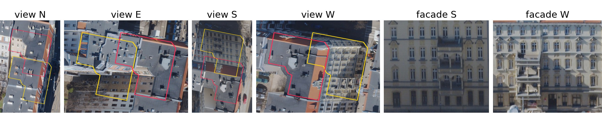
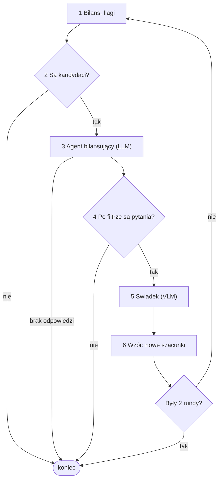

# Architektura

Żaden model nie podaje liczby mieszkańców. VLM opisuje budynek, a liczbę liczy wzór. Szacunku budynku nie skalujemy do spisu NSP 2021, więc spis wpływa na wynik tylko przez rubrykę i pytania agenta. Wzór nie potrzebuje sumy kwadratu, więc działa też dla osiedli oddanych po spisie.


Rysunek z artykułu; *Estimator* to na nim wzór, nie pole `estymator` z TOML. Upraszcza trzy rzeczy: pierwsze przejście świadka jest przed opcjonalną pętlą, strzałka agent-świadek biegnie przez filtr w kodzie, a o budynek można pytać też bez flagi. Przykład jednego budynku krok po kroku jest w README.

## Dane w kodzie

| Postać | Co zawiera |
| --- | --- |
| Budynek | wiersz GeoDataFrame o id `lokalnyId` z BDOT10k: obrys, `funkcja`, `kategoria` (stan), `kondygnacje`, `h` (wysokość) |
| Kwadrat | kod `CRS3035RES125mN3135000E4814125` (współrzędne narożnika), `ludnosc` |
| Karta | pola rekordu oraz `widoki` i `fasady`: kierunek → obraz RGB, najwyżej 768 px |
| Obserwacja | JSON świadka: `typ`, `kondygnacje`, `udzial_mieszkalny` (0-1), `stan` (`uzytkowany`, `w_budowie`, `pustostan`), `pewnosc`, `uzasadnienie` |



Wejście świadka dla kamienicy przy Piastowskiej 36: widoki z obrysem podstawy (żółty) i dachu (czerwony) oraz fasady, tu bez fasad N i E. Podstawa leży na gruncie, więc bywa przykryta dachem sąsiada. Model dostaje do 8 obrazów. Każdy ma podpis, np. `Widok N: kamera patrzy na północ, widać ścianę południową.`, a rekord to powierzchnia, funkcje, kondygnacje, stan i wysokość z OSM.

| Wynik w `wyniki/` | Wiersz | Główne kolumny |
| --- | --- | --- |
| `eksperymenty/<przebieg>.csv` | budynek | `budynek`, `mieszkancy` (wynik), `blad` (wyjątek); z modelem też obserwacja i `koszt_usd`; z pętlą też `typ_r0` itd. (przed pętlą), `mieszkancy_r0`, `_r1`, `_r2`, `dopytany`, `zmieniony`, `nowa_zabudowa` |
| `…__bilans.csv` | kwadrat po rundzie | `kod`, `ludnosc`, `szacunek` (po skali), `iloraz`, `flaga`, `runda` (stan po tylu rundach, 0: przed pętlą) |
| `…__dialog.csv` | zdarzenie rozmowy | `runda`, `rodzaj` (`kwadrat`, `pytanie`, `nowa_zabudowa`), `kod`, `diagnoza`, `uzasadnienie`, `budynek`, `atrybut`, `pytanie`, `odpowiedz`, `zmiana`, `mieszkancy_przed`, `_po` |
| `eksperymenty.sqlite` | wywołanie modelu | `rola`, `prompt`, `odpowiedz`, tokeny, koszt, czas |

## Agenci

Agent to jedno bezstanowe wywołanie modelu bez narzędzi, z odpowiedzią w JSON wymuszonym schematem. Stan trzyma kod, a wszystkie role obsługuje jeden `model` z TOML. Wywołania idą przez `llm.Klient`, który zapisuje je w SQLite: powtórka jest darmowa, a każda zmiana promptu oznacza nowe, płatne wywołania.

| Agent | Kiedy | Dostaje | Zwraca |
| --- | --- | --- | --- |
| Agent rubryki (LLM) | raz na przebieg przy `rubryka = "llm"` | listę klas | `osoby_na_dom`, `gestosci` |
| Świadek (VLM) | raz na budynek | obrazy, przy `z_rekordem = true` też rekord; nigdy spisu | obserwację |
| Agent bilansujący (LLM) | raz w rundzie z kandydatami | kwadraty z flagą (spis, szacunek, obserwacje i szacunki budynków), budynki sprzeczne z rekordem, historię pytań; nigdy obrazów | `kwadraty` (diagnozy), `pytania`, `nowa_zabudowa` |
| Świadek, dopytanie (VLM) | raz na pytanie po filtrze | to co świadek, poprzednią odpowiedź, pytanie | całą obserwację od nowa |

Pełne prompty są w kodzie, a po angielsku w dodatku artykułu.

## Pętla

Świadek i wzór przechodzą najpierw raz przez każdy budynek. Przy `estymator = "petla"` rusza potem `petla.uzgodnij`, a każdą wiadomość przekazuje kod. Debaty agentów potrafią zbiec do złej odpowiedzi (Du i in. 2024), więc pętla nie wymusza zgodności ze spisem.



1. `bilans`: szacunki sumujemy w kompletnych kwadratach i mnożymy przez wspólną skalę, żeby suma równała się spisowi. Skala nie trafia do szacunków budynków. Flaga to różnica ponad 1,5 raza w dowolną stronę i co najmniej 25 osób.
2. Kandydaci to budynki z kwadratów z flagą oraz budynki sprzeczne z rekordem, także spoza tych kwadratów (`sprzeczny`): świadek i BDOT10k różnią się co do tego, czy ktoś tu mieszka.
3. Agent stawia diagnozę (`blad_swiadka`, `nowa_zabudowa`, `rubryka`, `szum_spisu` albo `nieznana`) i wybiera, o co pytać. Diagnozy i lista `nowa_zabudowa` trafiają tylko do zapisu. Brak odpowiedzi to odmowa modelu albo limit tokenów.
4. `wazne_pytania` przepuszcza pytania tylko o kandydatów i o `typ`, `udzial_mieszkalny` albo `stan`, jedno na budynek w rundzie, najwyżej 20 na rundę, bez powtórki pary budynek i atrybut. Cyfry zmienia na `…`, żeby świadek nie poznał liczb ze spisu.
5. Odpowiedź świadka zastępuje poprzednią obserwację, więc pytanie o `typ` może zmienić też udział.
6. Wzór liczy od nowa wszystkie budynki. Tylko tak zmienia się szacunek; rubryki pętla nie zmienia.

Skutki `z_rekordem` (ocena kolista sprawdza model danymi, które już widział):

| | `true` | `false` |
| --- | --- | --- |
| Świadek i agent widzą rekord | tak | nie |
| Kandydaci ze sprzeczności | tak | nie |
| Typ `inny` | klasa z rekordu, jeśli zamieszkany | 0 |
| F1 względem BDOT10k | kolisty | uczciwy |

## Wzór i rubryka

```text
dom:         mieszkańcy = osoby_na_dom × udział mieszkalny
mieszkania:  mieszkańcy = powierzchnia zabudowy × kondygnacje × udział mieszkalny × gęstość[klasa] / 100
```

| Klasa (`estymatory.klasa`) | Typ od świadka | Rubryka L2 (na 100 m²) |
| --- | --- | --- |
| dom | `dom_jednorodzinny`, `szeregowiec` | 3,21 osoby na dom |
| `wielorodzinny_niski`, do 5 kondygnacji | `kamienica`, `blok_prl`, `blok_nowy` | 2,05 |
| `wielorodzinny_wysoki`, powyżej 5 | te same | 1,38 |
| `zbiorowy` | `zbiorowy` | 0,22 |
| brak, 0 osób | `uslugi`, `przemysl`, `garaz`, `inny` (wyjątek wyżej) | |

Stan inny niż `uzytkowany` też daje 0. Powierzchnia i kondygnacje pochodzą z BDOT10k także przy `z_rekordem = false`. `pewnosc` czyta tylko agent bilansujący.

Rubryka L1 pochodzi od agenta rubryki, a L2 z `kalibracja.py`: regresja z nieujemnymi współczynnikami ludności kwadratu na liczbę domów i powierzchnię kondygnacji w każdej klasie. Dopasowanie pomija kwadraty arkusza. Porównanie z wartościami z literatury jest w README.

## Co było zrobione

`estymator` wybiera części systemu: `objetosc` i `objetosc_bdot` działają bez modelu i rubryki, `wzor` dodaje świadka i rubrykę, a `petla` pętlę. L1, L2 i L3 to poziomy z artykułu: L1 i L2 to źródła rubryki (`rubryka = "llm"` albo plik TOML), L3 to pętla. Przebiegi, każdy wykonany raz:

| Przebieg | `estymator` | Model, rekord, rubryka | Budynki | Wynik |
| --- | --- | --- | --- | --- |
| `objetosc` | `objetosc` | - | 341 | Spearman 0,31, WAPE 0,70 |
| `objetosc_bdot` | `objetosc_bdot` | - | 341 | Spearman 0,85, WAPE 0,21: baseline do pobicia |
| `arkusz_haiku` | `petla` | Haiku, z rekordem, L2 | 341 | przed pętlą Spearman 0,89, WAPE 0,16; 0,29 USD |
| `model_{haiku,sonnet,opus}_s2_bez_tabeli` | `wzor` | 3 modele, bez rekordu, L1 | 40 | F1 0,95, 0,97, 0,97: różnice w granicach szumu |
| `petla_sonnet_proba` | `petla` | Sonnet, bez rekordu, L2 | 25 | pokaz: kwadraty dobrane celowo, stary prompt agenta; świadek zmienił blok na akademik po sugerującym pytaniu |

Przewagi nad baseline'em nie ma, bo przedziały różnicy obejmują zero. Wpływu obrazów i pętli jeszcze nie znamy: żaden przebieg nie wyłącza obrazów, a ocena po pętli jest kolista. Pojedynczego budynku nie ma czym sprawdzić, bo nie mamy danych o zużyciu wody.

Jeszcze nie ma: otwartego modelu (np. Qwen), świadka bez obrazów, placebo (obrazy innego budynku, przetasowane sumy), oceny na obwodach głosowania PKW. Wykresy i prawdziwe rozmowy: `notebooks/`.

## Gdzie co jest w kodzie

| Plik (domyślnie w `src/agenci/`) | Co tam jest, co tu zmienisz |
| --- | --- |
| `src/ortofoto/` | `arkusze.py`: TIF-y; `budynki.py`: BDOT10k + OSM; `wycinki.py`: wycinki, fasady, przesunięcie dachu `K` |
| `karta.py` | `Karta`, kolory obrysów |
| `llm.py` | `Klient`: dostawca modelu, pamięć odpowiedzi, `CENY` |
| `swiadkowie.py` | prompt i schemat świadka, `TYPY`, `dopytaj_swiadka` |
| `estymatory.py` | `ze_wzoru`, `klasa`, `PROG_WYSOKI`, `rubryka_llm`, baseline'y: tu dopisujesz nowy (funkcja karta → liczba) |
| `statystyka.py`, `kalibracja.py` | NSP 2021 i kwadraty; rubryka L2 |
| `petla.py` | `bilans`, `sprzeczny`, `wazne_pytania`, `uzgodnij`, prompt agenta; `PROG_ILORAZU` 1,5, `MIN_OSOB` 25, `RUNDY` 2, `MAX_PYTAN` 20 |
| `eksperyment.py` | `Konfiguracja` (pola TOML), rejestr baseline'ów `BASELINE` |
| `ewaluacja.py` | zgodność z BDOT10k, sumy w kwadratach, bootstrap |
