# Dziennik odkryć

Tu zapisujemy momenty „eureka!”: co nas zaskoczyło w danych, co nie działało i dlaczego, jaki pomysł zmienił architekturę. Z tego powstanie kiedyś artykuł blogowy o tym, jak budowaliśmy system, więc piszemy po ludzku i dodajemy zdjęcia. Obrazki leżą w `docs/odkrycia/`.

Nowy wpis dopisujemy na końcu, według wzoru:

```markdown
## RRRR-MM-DD: krótki tytuł, najlepiej z puentą

**Co zobaczyliśmy.** Konkretny budynek, liczba albo wykres, który nas zatrzymał.
**Dlaczego to ważne.** Co by poszło źle, gdybyśmy tego nie zauważyli.
**Co zmieniliśmy.** Decyzja w kodzie albo w podejściu.
**Zdjęcie.** 
**Liczby.** Przed i po, jeśli są.
```

---

## Wcześniej (daty przybliżone, do uzupełnienia)

### 2026-10-27: dach ucieka od kamery

**Co zobaczyliśmy.** Ortofotomapa skośna to ten sam teren sfotografowany pod kątem z czterech stron. Po nałożeniu przeciwnych widoków grunt się pokrywa, a dachy rozjeżdżają się w przeciwne strony. Żeby wyciąć ścianę budynku, trzeba wiedzieć, o ile dach jest przesunięty.
**Co zmieniliśmy.** Przesunięcie to wysokość × tan α. Najpierw zgadywaliśmy tan α „na oko”, potem dopasowaliśmy teksturę dachów między widokami na 61 budynkach: tan α = 0,96, czyli kamera odchylona o ok. 44° od pionu.
**Zdjęcie.** 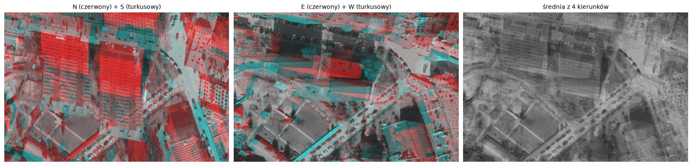 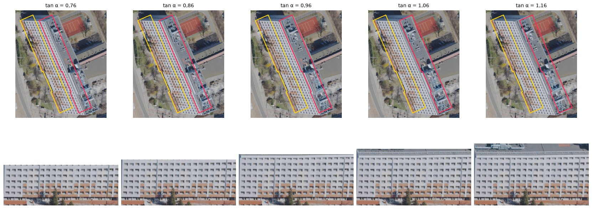

### 2026-11-10: liczba pięter nie mówi, jak wysoki jest budynek

**Co zobaczyliśmy.** Wysokość z liczby kondygnacji (3,3 m na piętro) myliła się o metry: budynki z 4 kondygnacjami mają tu średnio 18,5 m, bo kamienice mają wysokie stropy.
**Co zmieniliśmy.** Wysokość bierzemy ze skaningu laserowego GUGiK (NMPT minus NMT).
**Zdjęcie.** 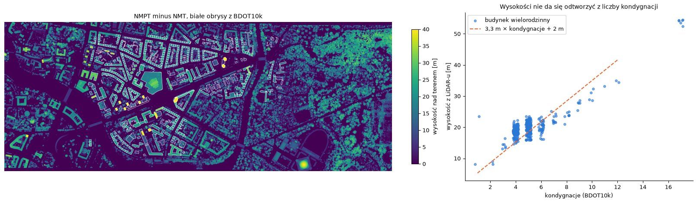 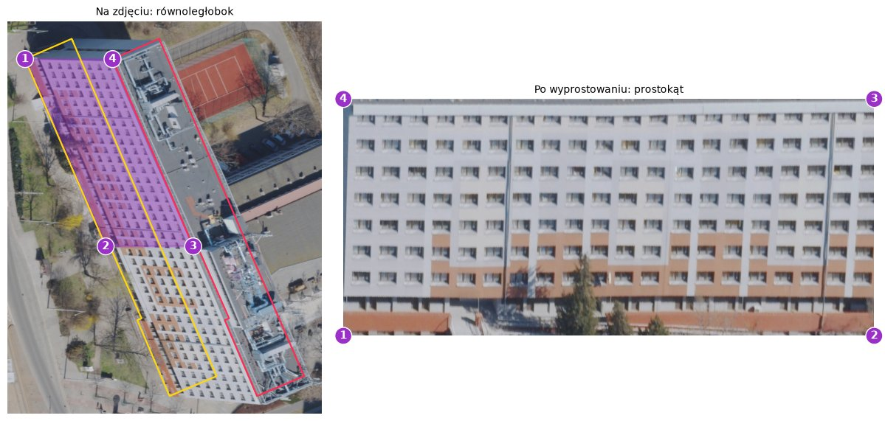

### 2026-11-10: akademik z 322 mieszkańcami w kwadracie, w którym spis widzi 33 osoby

**Co zobaczyliśmy.** Spis NSP 2021 liczy ludzi tam, gdzie są zameldowani, więc studenci „mieszkają” u rodziców. W kwadracie z akademikiem przy Piastowskiej 1 spis ma 33 osoby, a w budynku są 802 miejsca.
**Dlaczego to ważne.** Spis nie może być prawdą do oceny ani celem, do którego ciągniemy wynik.
**Co zmieniliśmy.** Ocena na SRLM (raport UWr: 893 506 rzeczywistych mieszkańców, o ok. 33% więcej niż w spisie), a spis zostaje tylko jako słaby sygnał w pętli.

### 2026-11-10: pierwszy pomysł na szperacza

**Co zobaczyliśmy.** Większość ludzi i większość błędu siedzi w kilku dużych budynkach, a uczelnie publikują liczbę miejsc w akademikach.
**Co zmieniliśmy.** Agent z wyszukiwarką internetową szuka liczby miejsc albo mieszkań dla największych budynków. Pierwszy duży sukces: 802 miejsca w Dwudziestolatce ze strony UWr.

---

## 2026-11-13: krytyczny przegląd przed przebiegiem na całe miasto

### Sama baza budynków z tabelką ze stałymi daje to samo co VLM

**Co zobaczyliśmy.** Porównaliśmy system z wariantem bez modelu: rekord BDOT10k i stałe z literatury. Na 82 kwadratach spisu wyszło to samo, różnica w zgodności ze spisem −0,009 [−0,03; +0,01]. Model, który ogląda zdjęcia, nie wnosił nic mierzalnego.
**Dlaczego to ważne.** To pytanie, czy w ogóle potrzebujemy VLM, i czy wykorzystujemy to, co on widzi.

### Odejmowaliśmy sklepy dwa razy

**Co zobaczyliśmy.** Stała 37,08 m² na osobę (Pirowski i Bartos 2018) jest liczona na całej powierzchni budynków mieszkalnych, razem z klatkami i sklepami w parterach. A model i tak mnożył wynik przez „udział mieszkalny” 0,8–0,95, prawie zawsze, nawet w blokach bez żadnych usług. Wartość 1,0 nie padła ani razu na 450 takich blokach.
**Dlaczego to ważne.** Systematyczne −13% mieszkańców w blokach, a model po prostu się asekurował.
**Co zmieniliśmy.** 1 znaczy „typowy budynek tej klasy”, model najpierw pisze uzasadnienie, potem liczby, i ma wpisać 1, gdy nie widzi konkretnego powodu.
**Liczby.** Po zmianie udział 1 ma 376 z 456 zamieszkanych budynków; poziom wobec SRLM wzrósł z 0,84 do 1,01.
**Zdjęcie.** 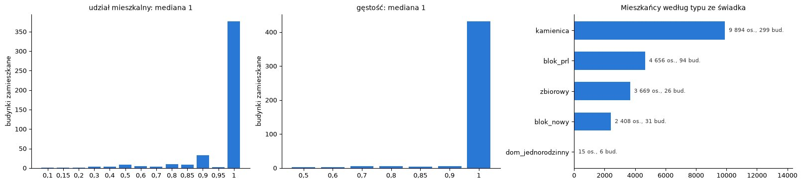

### Mnożnik powyżej 1, czyli „kurniki”

**Co zobaczyliśmy.** Udział mieszkalny mógł tylko obniżać wynik, a w mieście są mikrokawalerki i mieszkania na pokoje, gdzie mieszka gęściej niż przeciętnie.
**Co zmieniliśmy.** Drugi mnożnik, gęstość (0,3–3): model doważa stałą z literatury tym, co wie o architekturze.
**Liczby.** Na trzech arkuszach model ani razu nie dał gęstości powyżej 1. Ciąg dalszy niżej (Starter).

### Jeden arkusz to za mało, żeby cokolwiek ocenić

**Co zobaczyliśmy.** Rejony SRLM są większe, niż myśleliśmy: żaden nie leżał w całości na jednym arkuszu (najwięcej 81%).
**Co zmieniliśmy.** Dobraliśmy dwa sąsiednie arkusze tak, żeby trzy rejony były pokryte w całości.
**Zdjęcie.** 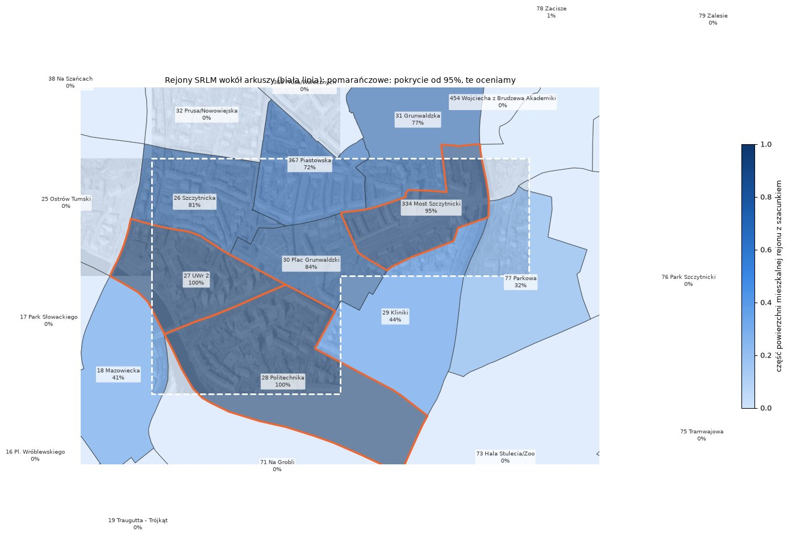 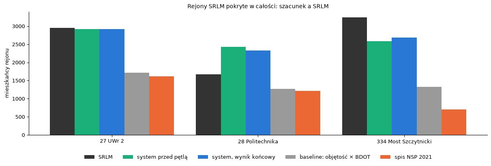

### Szperacz policzył akademik dwa razy

**Co zobaczyliśmy.** Ewidencja dzieli jeden akademik na kilka segmentów. Szperacz dał 802 miejsca jednemu segmentowi, a sąsiednie zostały przy wyniku ze wzoru.
**Co zmieniliśmy.** Stykające się segmenty szukamy razem i dzielimy liczbę według powierzchni. Potem okazało się, że to skleja trzy osobne akademiki spięte łącznikami (pl. Grunwaldzki 26 i 28, Grunwaldzka 59), a szperacz sam napisał, że to trzy różne budynki. Najpierw spróbowaliśmy łączyć tylko segmenty z tej samej działki ewidencyjnej; to okazało się gorsze (wpis niżej).

### Baner „Szkoła pływania” obniżył liczbę mieszkańców bloku

**Co zobaczyliśmy.** 9-piętrowy blok przy Grunwaldzkiej 106 dostał udział mieszkalny 0,6, bo na ścianie wisi wielka reklama szkoły pływania. Mural na sedesowcu przy pl. Grunwaldzkim obniżył udział do 0,8.
**Co zmieniliśmy.** Prompt: obniżaj tylko wtedy, gdy całe piętra powyżej parteru wyglądają na niemieszkalne; reklamy, banery i murale nie są powodem.
**Zdjęcie.** 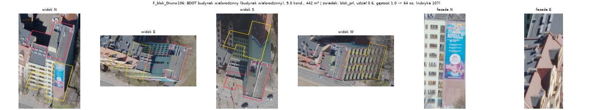 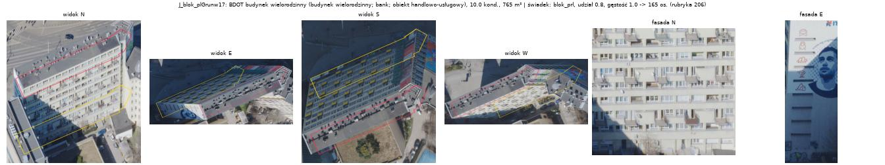

### Uczelnia jako akademik, czyli model dzieli różnicę

**Co zobaczyliśmy.** Gdy baza mówi „szkoła wyższa”, a zdjęcie jest niejednoznaczne, model wybiera „akademik, udział 0,5”: 340 mieszkańców w budynku uczelni przy Norwida. Ten sam odruch asekurowania przeniósł się z bloków na budynki niemieszkalne: 25 takich budynków dostało 789 osób, przy pewności średnio 0,47 wobec 0,64 przy budynkach mieszkalnych.
**Co zmieniliśmy.** Model najpierw odpowiada tak albo nie, czy widać ślady mieszkań (pranie, rośliny, różne zasłony, anteny), a budynek niemieszkalny w bazie dostaje mieszkańców tylko przy „tak” i pewności co najmniej 0,6.
**Zdjęcie.** 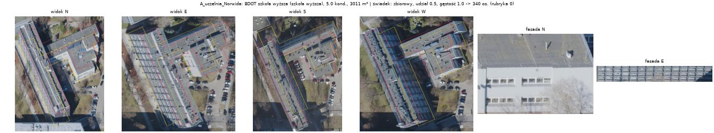

### Zabite okna: tu model naprawdę coś widzi

**Co zobaczyliśmy.** Kamienica przy Benedyktyńskiej 26 dostała gęstość 0,7, bo na ostatnim piętrze widać zabite deskami okna. To dokładnie ten sygnał, którego nie ma w żadnej bazie.
**Zdjęcie.** 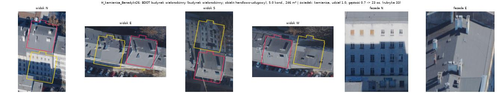

### Kościół, w którym obrysy nie pasują

**Co zobaczyliśmy.** Przy złożonej bryle (kościół i klasztor przy pl. Grunwaldzkim 3) obrys dachu wyraźnie rozjeżdża się z budynkiem, a baza nie ma liczby kondygnacji. Model widzi pomieszane bryły i zgaduje.
**Zdjęcie.** 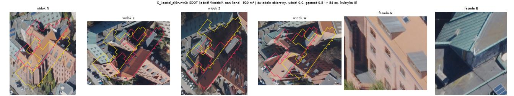

### Hotel, który jest akademikiem z mikrokawalerkami

**Co zobaczyliśmy.** Dwa budynki na naszych arkuszach baza BDOT10k ma jako hotel, więc wzór dawał im 0 mieszkańców. Wyszukiwanie adresów pokazało, że to Starter I (wybrzeże Pasteura 18, dawny Hotel Asystenta UWr, 149 kawalerek po 11–27 m²) i Starter II (pl. Grunwaldzki 57): prywatne akademiki z mikroapartamentami. To są szukane „kurniki”. Od 2018 r. mieszkanie musi mieć co najmniej 25 m², więc mniejsze jednostki sprzedawano jako lokale użytkowe, aparthotele i prywatne akademiki, i w bazie wyglądają jak hotele. Z powietrza też.
**Dlaczego to ważne.** Gęstość od modelu tego nie złapie, bo nie ma czego zobaczyć. W mieście jest ok. 210 budynków z funkcją hotelu.
**Co zmieniliśmy.** Szperacz sprawdza zawsze wszystkie akademiki, internaty i hotele z BDOT10k i ustala, czy ludzie mieszkają tam na stałe; kawalerka to jedno miejsce, zwykły hotel dla turystów to zero.
**Zdjęcie.** 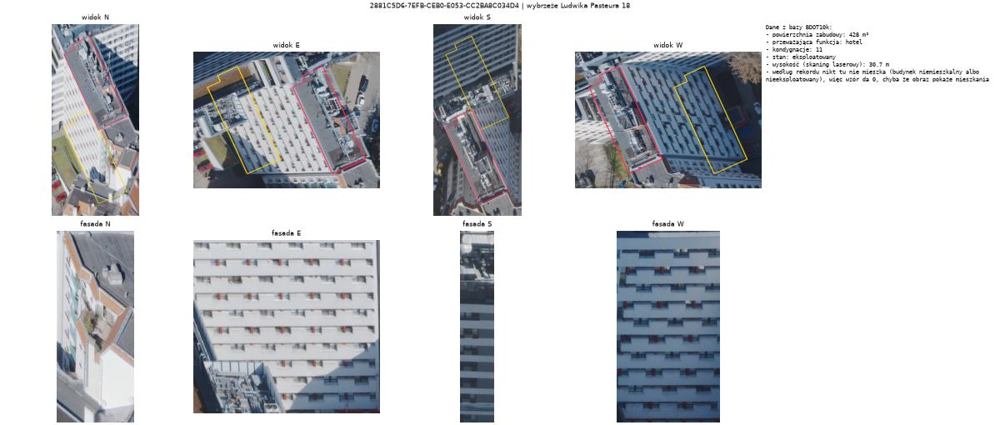

### Liczby ze szperacza to jedyna prawda dla pojedynczego budynku

**Co zobaczyliśmy.** Dla akademików, w których szperacz znalazł liczbę miejsc, wzór był zawsze za niski: 802 wobec 451, 336 wobec 307, 503 wobec 430. Polskie akademiki mają 17–28 m² na miejsce, a nasza stała z amerykańskiej ankiety zakłada 31.
**Dlaczego to ważne.** Pierwszy raz mamy z czym porównać pojedynczy budynek, bez spisu i bez SRLM.
**Co zmieniliśmy.** Szperacz dla wszystkich akademików w mieście; do zrobienia: polskie źródło stałej dla zamieszkania zbiorowego.

### Agent pyta o piętra, których już nie używamy

**Co zobaczyliśmy.** Agent bilansujący prosi świadka o policzenie kondygnacji, choć wzór bierze je z BDOT10k.
**Do zrobienia.** Powiedzieć agentowi wprost, żeby o kondygnacje nie pytał.

### SRLM nie wspomina o hotelach ani słowem

**Co zobaczyliśmy.** W 68-stronicowym raporcie UWr, z którego pochodzi SRLM, nie pada słowo „hotel”, „aparthotel” ani „mikroapartament”. Z BDOT10k autorzy biorą tylko cztery klasy budynków mieszkalnych (jednorodzinne, o dwóch mieszkaniach, wielorodzinne, zbiorowego zamieszkania), a poprawkę „95% miejsc z internetu” robią tylko dla akademików i burs, które BDOT ma w klasie zbiorowego zamieszkania (rozdz. 3.1 i 3.3). Prywatny akademik zapisany jako hotel tej poprawki nie dostaje. Jego mieszkańcy mogą wejść do SRLM tylko przez liczbę lokali z GUS i meldunki, liczeni jak przeciętne mieszkanie, czyli ok. 2 osoby na lokal, a nie 1 osoba na kawalerkę. Autorzy sami piszą, że zdjęcia lotnicze grożą przeszacowaniem tam, gdzie zabudowa nie jest mieszkaniowa: to dokładnie nasz problem z uczelniami.
**Dlaczego to ważne.** Oba budynki Startera (ok. 12 tys. m² brutto) leżą w rejonie Most Szczytnicki, w którym byliśmy o 17% poniżej SRLM. Rozjazd w takim rejonie może być błędem po każdej ze stron. Dlatego rejony z hotelami i prywatnymi akademikami trzeba czytać osobno, a nie stroić pod nie promptu.

### Jeden akademik policzony cztery razy

**Co zobaczyliśmy.** Po zmianie grupowania na „ta sama działka” kompleks akademików przy pl. Grunwaldzkim rozpadł się na kilkanaście kawałków, a część z nich nie ma w ewidencji ani adresu, ani działki. Szperacz dostawał dla takiego kawałka adres najbliższego sąsiada i znajdował jego akademik. Parawanowiec (ok. 200 miejsc) trafił w ten sposób do czterech grup, czyli ok. 800 osób, a Słowianka (330 miejsc) do kawałka, któremu wzór dawał 18 osób.
**Dlaczego to ważne.** Dane w BDOT10k są dzielone na segmenty po swojemu (granice działek, łączniki, przybudówki), a liczba z internetu dotyczy budynku, który zna student, nie ewidencja. Dopasowanie jednego do drugiego to osobny problem.
**Co zmieniliśmy.** Wróciliśmy do łączenia stykających się segmentów; przy kompleksie kilku akademików szperacz podaje sumę ich miejsc albo brak. Kawałków bez własnego adresu nie szukamy wcale, zostaje dla nich wynik wzoru.

### Wynik po wszystkich poprawkach: model przestał zgadywać, pętla zaczęła pomagać

**Co zobaczyliśmy.** Przebieg na trzech arkuszach po zmianach z tego dnia (reguła udziału, ślady mieszkań z progiem pewności, wiedza o gęstości w prompcie, szperacz dla wszystkich akademików i hoteli):
- udział 1 ma 425 z 434 zamieszkanych budynków (rano 376 z 456), a reklamy i murale przestały obniżać wynik;
- budynki niemieszkalne w BDOT10k dostały mieszkańców w 6 przypadkach zamiast 25 (rano 789 osób);
- gęstość powyżej 1 pojawiła się pierwszy raz (7 budynków: wysokie akademiki, bloki z gęstym rytmem małych okien);
- pętla pierwszy raz naprawiła coś istotnego: budynek uczelni opisany jako akademik z 237 osobami po pytaniu agenta dostał zero, bo świadek nie zobaczył śladów mieszkań;
- szperacz znalazł Startera na portalu urbanity.pl jako 170 lokali (liczy je jako mieszkania po 1,71 osoby, przy kawalerkach to za dużo).
**Liczby.** Poziom wobec SRLM na trzech rejonach 1,03, WAPE 0,10 (rano 1,01 i 0,16; baseline 0,55 i 0,21). Rejony: UWr 2 0,96, Politechnika 1,26, Most Szczytnicki 0,97. W rejonie Politechnika wynik jest prawie równy samej rubryce z bazy: za dużo dają tam stałe (kamienice i klasztory), nie model.
**Po drodze.** Przy pierwszym podejściu API zwracało przejściowe błędy, a przy drugim skończyły się środki na koncie; plik wznowienia uratował 661 gotowych odpowiedzi świadka.
**Zdjęcie.** 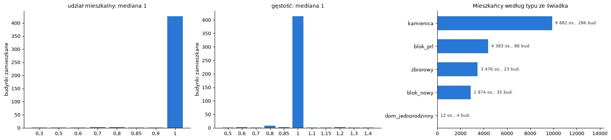 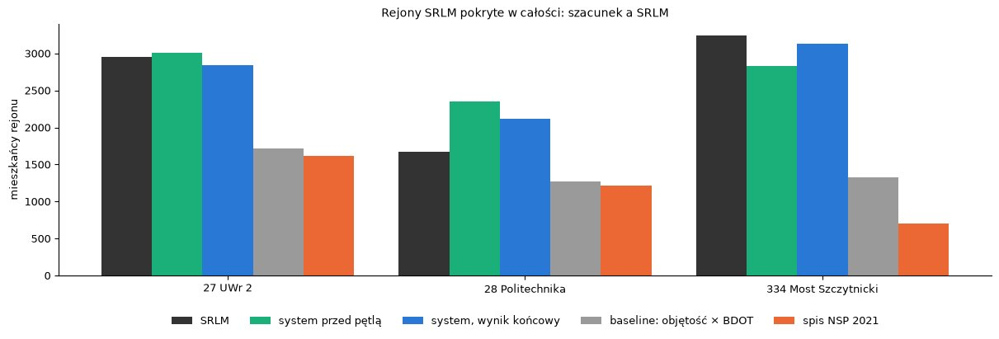

